# MES UI 自动化测试方案（整合评审稿 v0.4）

更新日期：2026-10-06。全量枚举已按最新确认调整为包含非法组合；PICT 用于后续冒烟候选集。

**建议采用：源码辅助建模、有限配置组合生成、Playwright 确定性执行、独立策略断言和受控恢复。保留一条“主配方配置 → 工单 → 生产执行”完整 UI 主链路，以数值控件和一种称重模式建立可复用的第一组能力。**

本文整合原项目方案与 [设计MES UI自动化方案](chatgpt-conversation://6ab7cb38-2a34-83ec-bf75-40b07199fb0a) 中的五轮讨论，并核对本项目 ASCII 页面资料。目标是给出能逐步建设、便于维护的推荐架构；图中模块是代码职责，不意味着要部署多个服务。

你已说明具备独立测试环境、前后端源码、接口文档、数据库、Redis，以及设备或模拟器。本目录已有 Vue 练习站和独立全量配置枚举包，尚未接入真实 MES。具体本地证据见各组件验收记录；本文中的执行架构不代表真实 MES 验收通过。引用聊天里的示例组合数量和示例代码包不作为本项目的运行证据。

## 1. 整合后的关键取舍

| 讨论中的方向 | 本方案的选择 | 理由 |
|---|---|---|
| 完整业务链路与两个控件 MVP | 保留完整主链路；两个控件承担首批深入测试 | 全链路验证模块衔接，短场景定位复杂规则；不把聊天中的缩小范围建议当作你已同意 |
| 源码扫描与自动编排 | AI 先分析一个纵向模块，生成动作清单和测试草稿，经核对后固化 | 减少手写点击；暂不自建全仓库静态分析平台 |
| BFS 与 DFS | BFS 探索编辑状态；DFS 在内存中枚举全部候选并分类合法/非法 | 页面可达性与配置组合是两种问题，非法目标需要转为拒绝或自动修正测试 |
| 全组合与 PICT | 全量包含非法组合；PICT 用于后续冒烟候选集 | 成对覆盖不能冒充“全部配置都执行过” |
| 状态机与运行时 AI | 用轻量状态表管理执行与恢复，日常回归无需调用大模型 | 让路径选择可解释、可复现；未知状态停止并报告 |
| 复杂断言 | 结果、写入、显示分别计算，UI/API/DB/Redis 提供事实 | 共用显示规则，同时避免前后端一起错却一起通过 |
| 自动恢复与自动修复 | 执行期只允许登记过的恢复动作；代码修复进入评审 | 原失败证据和正确性标准不能被“修到通过”覆盖 |

**图 1：建设和运行分成两个阶段，共用同一套规则。**

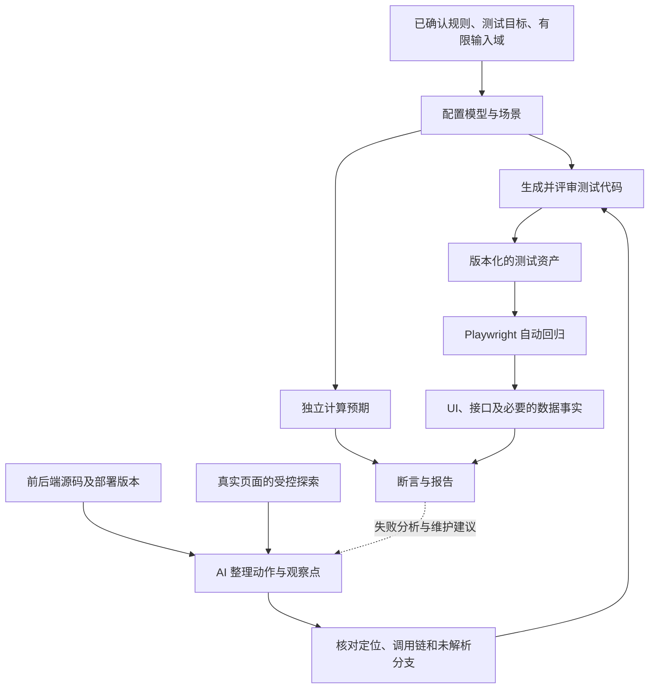

维护的是一个测试工程和少量业务适配器。配置模型、动作定义、显示策略均先用普通 TypeScript 数据和函数表达，不建设测试后台、自定义脚本语言或通用流程引擎。

## 2. 总体架构与主链路

**图 2：运行架构。** 业务动作走合法入口，数据库和 Redis 客户端只观察事实；测试预期不由被测服务替测试判定。

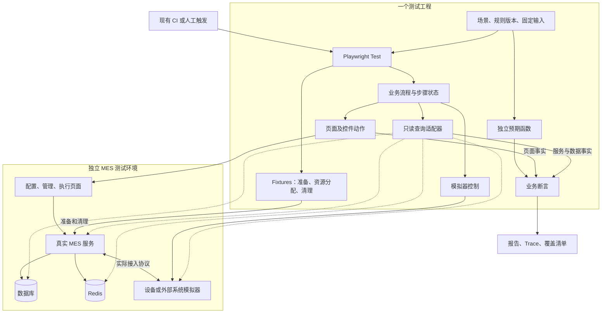

若设备经客户端本地程序接入，模拟器应接到实际通道；不能照图假设所有设备都直接连接后端。日常主链路保留真实 MES 前后端和存储，浏览器层伪造执行接口成功只能证明前端表现。

**图 3：主链路设置四个检查点，前一步通过才继续。**

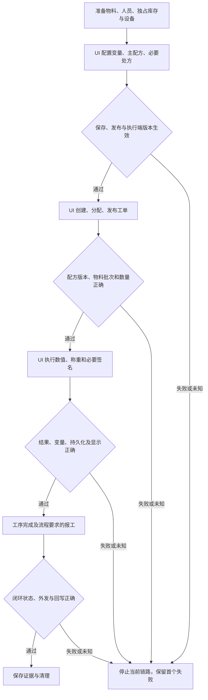

首条基准配方建议限制为一种物料、一种称重模式、一种明确签名规则、一个可完成的工序，并包含数值控件。具体模式和签名类型在规则确认时选择。已有页面显示四种称重模式和多种签名类型，不可直接合并成一种通用流程。

| 套件 | 受测范围 | 数据与执行方式 |
|---|---|---|
| 完整主链路 | 三模块衔接、配置生效和版本传递 | 受测配置、工单、执行动作走 UI；稳定前置资料可由 API 准备 |
| 控件配置套件 | 表单分支、合法保存、重开回显、非法拒绝 | 每个配置用独立草稿，通过 UI 设置和保存 |
| 控件执行套件 | 指定配置下的结果、变量、显示和副作用 | API 准备非受测前置条件，UI 完成目标控件动作 |
| 服务集成套件 | 规则组合、权限、并发、幂等、事务、锁与缓存 | 调用真实服务，按风险观察 DB、Redis 和对端 |
| 真实联调套件 | 真实设备、协议、外部系统和物理结果 | 单独记录设备、环境和证据 |

完整主链路与短场景独立准备数据。API 创建的资源不计入相应新建页面覆盖；模拟器验证也不等于真实设备验收。“设备模拟器”与产品中的“模拟工单”不同，需验证正式工单逻辑时应使用隔离环境中的相应工单类型。

## 3. 怎样减少手写步骤

人主要提供业务目标、输入、正确结果和允许的前置准备方式；AI 根据源码及运行观察生成动作草稿，复用动作编排流程。首期直接分析数值与称重控件相关纵向代码，不先开发通用 AST 平台。

**图 4：从实现资源到可执行步骤。**

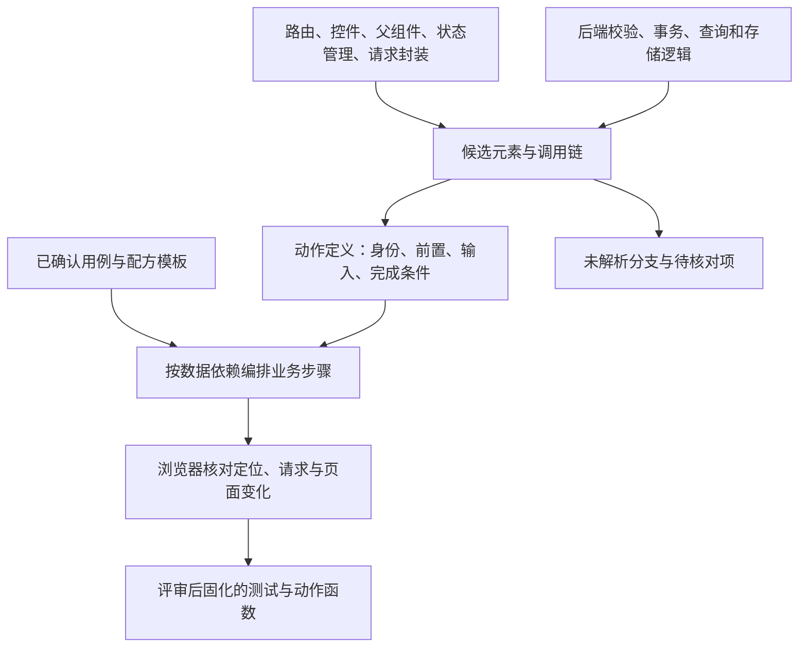

每个动作只保留真正需要的契约：

| 内容 | “确认称量”的示意 |
|---|---|
| 对象身份 | 组织、工单、步骤、控件实例、物料批次、当前角色 |
| 前置状态 | 目标对象正确，指定配置已生效，批次和设备就绪 |
| 输入与定位 | 固定读数或模拟器事件，在指定控件范围定位按钮 |
| 实现依据 | 元素 → 事件 → 父组件/状态管理 → 请求封装 → 后端处理；记录源码版本 |
| 请求关联 | 方法、路径及工单/步骤/批次字段；一个按钮可能触发多个请求 |
| 完成与失败 | 关联操作的成功/拒绝终态，以及页面应发生的变化 |
| 副作用 | 是否提交业务结果、是否自动保存、结果未知时怎样核查 |
| 正确性依据 | 独立规则编号、预期结果、禁止副作用及时间预算 |

源码事实、浏览器验证、业务规则分别记录状态。源码存在的按钮不保证当前角色可见；当前页面不可达的分支记录差异，不从规则清单删除。公共请求拦截器可能改变组件收到的响应结构，网络断言要核对原始响应。

长流程采用普通函数组合：配置动作输出配方版本，工单动作输出实际工单 ID，执行动作输出实际记录 ID，后续步骤消费这些结果。缺少必要输出或检查点未通过就停止。先核对测试模板与实际生效控件树，不能因页面缺少复核控件而自动跳过复核。

定位优先选择角色、标签、稳定 test id，并限定业务行或控件实例。当前资料中的重复 prop、隐藏“确定”、固定列克隆和 Handsontable 都要求浏览器核对；不可用“第一个结果”或固定行号代替业务身份。

代码变更后可按“源文件 → 动作 → 用例”优先运行受影响场景；公共封装或未知动态依赖扩大回归范围。生成器不能随实现变更自动删除业务断言。

## 4. 配置遍历如何设计

“全部配置”定义为**已确认有限取值域内的全部候选组合，包含合法与非法组合**。输入框包含无限或极大空间，需要先选定边界、等价类和代表值；变量弹框的“特征覆盖”与“遍历全部变量对象”也分别建套件。非法目标用于正常 UI 的阻止、联动或保存校验测试，不要求页面实际进入非法状态；当前不实施绕过 UI 的数据测试。

**图 5：四种覆盖分别生成，不能互相替代。**

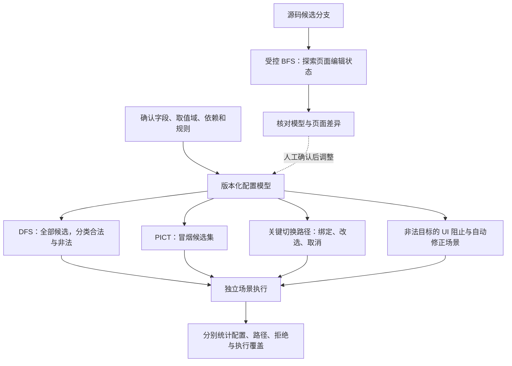

### 4.1 模型保留什么

| 模型内容 | 用途 |
|---|---|
| 字段 ID、类型、有限取值、值来源 | 生成输入；动态列表映射到受控业务 ID |
| 显示条件与编辑依赖 | 驱动表单；必要时拓扑排序 |
| 最终合法约束 | 对完整候选分类并记录全部违规原因，不过滤非法组合 |
| 编辑阶段规则 | 描述开关切换、弹框取消、未填完等中间状态 |
| 关键迁移与非法场景 | 检查历史残留、互斥行为和拒绝逻辑 |
| 规则版本、源码版本、证据位置 | 复现与识别模型过期 |

互斥组独立表示，不把“A/B 互斥”写成循环依赖。字段仍未赋值属于“未知”，不能当成约束已违反。最终保存约束与合法编辑过程分离，例如开启变量绑定但尚未选变量，可以是合法中间状态。

`NA` 只表示模型中的“不适用”；查询失败或配置损坏不能变成 `NA`。隐藏字段在保存时清空、保留还是忽略，以业务契约决定，不能由生成器自行选择。

### 4.2 BFS 只探索有意义的页面状态

先由源码提供候选分支，再对称重编辑器和变量弹框做有限 BFS。每次从干净基线重放已知路径，执行一个允许动作，核对状态变化后入队。限制角色、数据集、深度、状态数和运行时间，耗尽预算标记“探索未完成”。

**图 6：示意编辑状态图，互斥行为仍需按真实规则确认。**

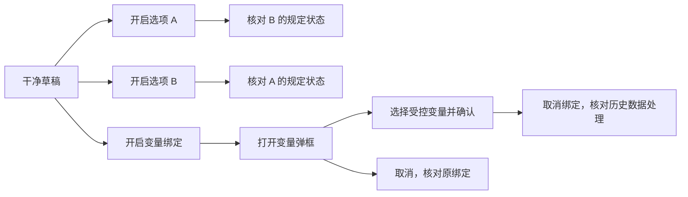

去重状态至少考虑影响后续行为的模式、选值、可见/可用字段、弹框、角色、配置版本和必要历史上下文；排除随机 DOM ID、时间戳等噪声。同 URL 不代表同状态，同可见 DOM 也未必代表同隐藏绑定。历史敏感路径若被普通去重合并，应在迁移套件单独保留。

探索以草稿为边界，不自动触发发布、投料等动作；若表单有自动保存，探索也按真实写操作隔离。DOM 可达性只提供观察事实，不能自动决定哪些组合应合法。

### 4.3 DFS 生成配置，表单驱动器执行配置

DFS 在内存中选字段值，完整赋值后检查全部约束；不得因为业务非法而剪枝。当前独立实现见 [配置枚举器](packages/config-enumerator/README.md)，采用索引向量实现固定顺序的深度优先笛卡尔积枚举，避免递归栈和全部结果缓存。case ID 由模型标识、版本和顺序号组成，CLI 额外记录模型指纹；字段、候选顺序或规则改变须更新模型版本。

```text
枚举(已选字段):
  如果字段全部赋值：检查全部规则，输出完整配置及合法/非法分类与违规原因
  否则：按声明顺序选择下一字段
        对每个候选值递归枚举
  若预算耗尽：返回未完成，不宣称全量
```

模型格式错误在枚举前拒绝；违反业务规则属于正常输出。小模型用独立循环和已知合法/非法集合核对：A/B/C/D 全量为 16 条，合法 9 条、非法 7 条，其中同时违反多条规则的候选保留全部原因。生成完成不表示 UI 可达、执行完成或断言通过。

**图 7：每个配置的保存证据和执行证据分开产生。**

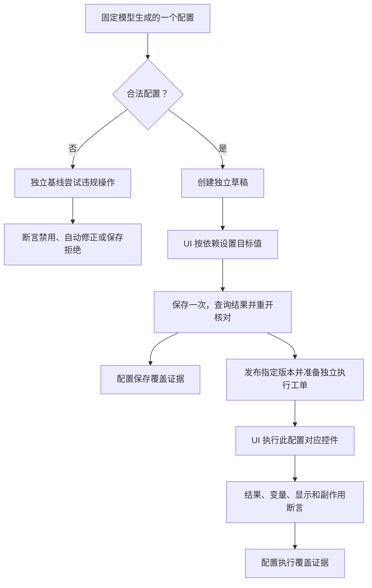

复选框设置为目标状态、输入框填目标值、弹框按业务 ID 选择；不要“再点一下”。自定义下拉与原生 select 分别适配。绝对值设置不等于服务端幂等，有自动保存时仍要核实写入结果。

每个组合注册成可单独报告的测试；不同组合不共享可变草稿。递归返回只撤销内存选择，不能撤销已保存的 MES 数据。完整主链路验证各关键新建 UI，组合套件可用 API 准备非受测工单，报告应标明此边界。

全组合的代价无法靠算法消失。先计算或界定组合数量，试跑测量单例耗时，再按资源占用安排批次；超预算保留未完成状态，不能暗中降级为成对覆盖。

### 4.4 PICT 的位置与覆盖账本

[PICT](https://github.com/microsoft/pict) 是微软的组合用例生成工具，支持有限参数、约束和组合阶数。默认两两覆盖；阶数等于参数数时可生成全阶组合。它不负责操作浏览器，也不自动发现业务规则。[官方模型说明](https://github.com/microsoft/pict/blob/main/doc/pict.md)

全量以包含合法与非法候选的 DFS 清单为基准；PICT 后续用于冒烟候选集，并补入必测主流程及关键非法场景。PICT 的正向组合约束从同一份确认模型导出，生成后检查每行合法性和约定组合覆盖；不能先生成再删非法行却不重新核查覆盖。记录工具版本、模型 hash、阶数和随机种子。高风险多条件交互显式加入，不能认为两两覆盖已验证它们。当前包仅实现全量枚举，PICT 尚未接入。

| 覆盖项 | 分母与证据 |
|---|---|
| 配置生成完整性 | 当前有限模型的全部候选集合，分别统计合法与非法；未完成枚举不能给出全量结论 |
| 配置保存覆盖 | 合法配置集合中，已完成 UI 保存与重开断言的配置 |
| 配置执行覆盖 | 合法配置集合中，已完成目标控件执行及必需断言的配置 |
| 快速组合覆盖 | 模型内要求的合法二元/多元组合；与全配置覆盖分开 |
| 迁移与拒绝覆盖 | 已评审的路径、守卫和负向场景清单；不是所有无限操作序列 |

同一 case ID 继续记录通过、失败、阻塞、未执行，覆盖到不等于通过。分批结果只有模型、产品构建、环境基线一致且无数据污染时才可合并；条件变化应重跑受影响范围。生成但未执行不计运行覆盖，保存通过不计生产执行通过。

## 5. 状态机怎样决定下一步

状态机是测试侧的一张“当前阶段 + 允许动作 + 转移条件”表。它可以结合页面事实决定下一步，但还必须知道业务目标、对象身份、角色、配置和上次提交结果。首版采用 TypeScript 状态与函数即可，不单独引入工作流服务或通用规划器。

**图 8：页面元素是决策输入之一，不能单独决定业务操作。**

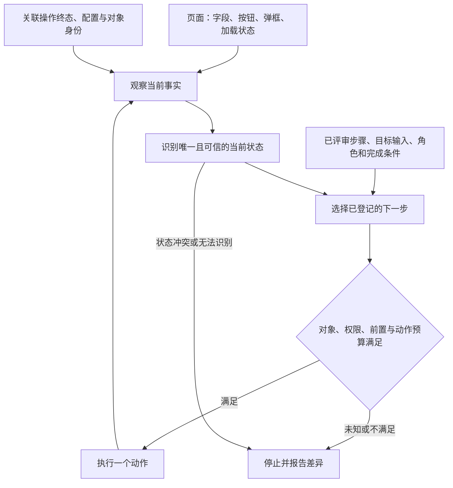

常用执行阶段可保持很少：待准备、就绪、已提交待结果、结果未知、结果验证、通过、失败/阻塞。变量值和配方配置放在上下文，不为每个数值创建一个状态；需要探索的历史敏感差异仍进入第 4 节的状态身份或专门迁移路径。

**图 9：提交边界与结果不明的处理。** 这是执行器模型，不是对 MES 内部状态名的假设。

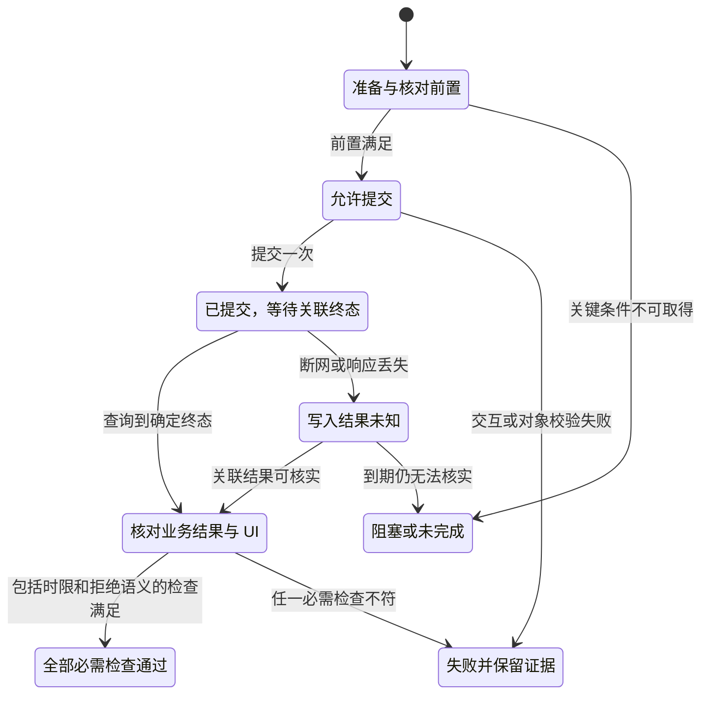

图中故意没有“结果未知 → 自动重新提交”。如果真实服务具备已确认的幂等契约，重发使用同一业务操作标识并作为专门策略验证；客户端自己生成随机 Key 并不产生服务端幂等能力。

| 观察到的情况 | 允许动作 | 判定规则 |
|---|---|---|
| 元素重渲染、目标行暂未出现 | 同一对象内重新定位、滚动、有界等待 | 在步骤预算内继续；不改变目标批次或控件 |
| 服务已受理且仍在处理 | 查询同一次操作 | 到终态后判断；超时保留最后状态 |
| 写请求响应丢失 | 按真实操作标识或业务唯一键核实 | 无法排除仍在处理时不重发；查不到一次不代表未执行 |
| 明确拒绝 | 核对拒绝原因和禁止副作用 | 负向用例可通过；正向用例失败，不自动改输入 |
| 后端成功但页面未按时更新 | 留存现场后，可重开作诊断 | 原 UI 检查仍失败；恢复证据单独记录 |
| 数值、版本、变量或单位错误 | 保留差异并停止 | 不改预期、不放宽精度、不省略断言 |
| 未知弹框、角色或对象冲突 | 截图和诊断，停止 | 不猜测点击“确定”，不自动换高权限账号 |
| 正常流程遇到意外网络故障 | 核实副作用，保留故障 | 恢复业务结果不自动抹掉本次流程故障 |

只有用例明确测试“断网后恢复”，恢复动作才是通过路径的一部分。安全恢复与脚本修复分开；Agent 可分析失败和建议补丁，补丁评审后重新执行，不能在发布门槛中自动跳过失败用例。

每步设置动作、查询和总耗时预算，连续无进展也结束。初期建议单 worker、整条用例 retries 为 0，先消除定位、等待和数据污染问题。以后诊断重跑需核实前次副作用、使用新隔离对象，首次失败仍保留为不稳定证据。[Playwright 重试行为](https://playwright.dev/docs/test-retries)

## 6. 断言如何分层并保证独立

**API、数据库和 Redis 都可以做断言。选择依据是它们能证明哪项业务事实，不要求每条 UI 用例都查全部层。**

**图 10：预期从规则和固定输入计算，实际从多个观察点读取。**

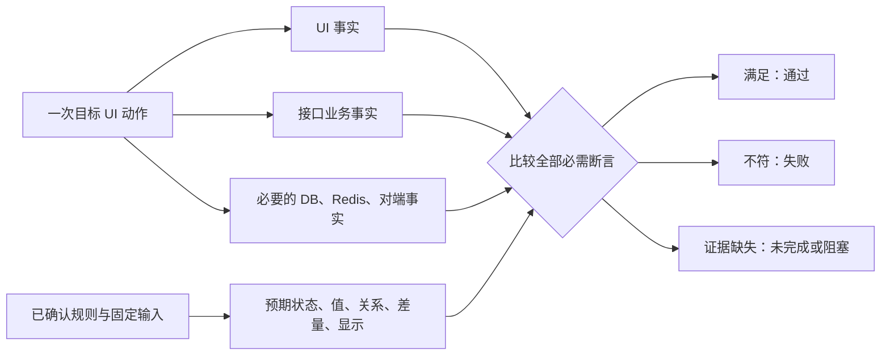

不能把接口实际值格式化后当成唯一预期，也不能直接调用生产格式化/计算函数生成标准答案。测试侧维护小范围独立规则和人工确认参考样例，不重写完整 MES。

| 观察层 | 推荐断言 | 不能仅凭它下的结论 |
|---|---|---|
| UI | 输入、校验、启用状态、结果文本、指定行、刷新回显 | Toast 或截图不能证明落库 |
| 动作响应 | 请求身份和参数、业务结果码、操作关联、拒绝原因 | HTTP 200/202 不等于完成；回显不等于持久化 |
| 查询接口 | 指定对象终态、生效版本、结果、变量实例和关系 | 缓存/读模型可能延迟，不能天然证明事务提交 |
| 数据库 | 已提交记录、库存流水和余额、唯一性、签名和审计关联 | 落库正确不能证明页面正确或对端完成 |
| Redis | 明确契约下的执行状态、缓存、锁、TTL 或会话 | Key 存在、删除或队列为空不等于业务成功 |
| 对端/模拟器 | 外发内容、实际接收、处理结果和 MES 回写 | 收到 HTTP 请求不等于对端业务完成 |

按事实登记权威来源、只读查询、身份范围、终态、时限和是否必需。若执行状态以 Redis 为权威，就按其契约观察；不能先规定数据库永远权威。必需事实查不到属于未完成，不降级为额外日志。

### 6.1 一次称重确认的数据流

**图 11：先监听、提交一次、只读查询、再核对展示和持久化。**

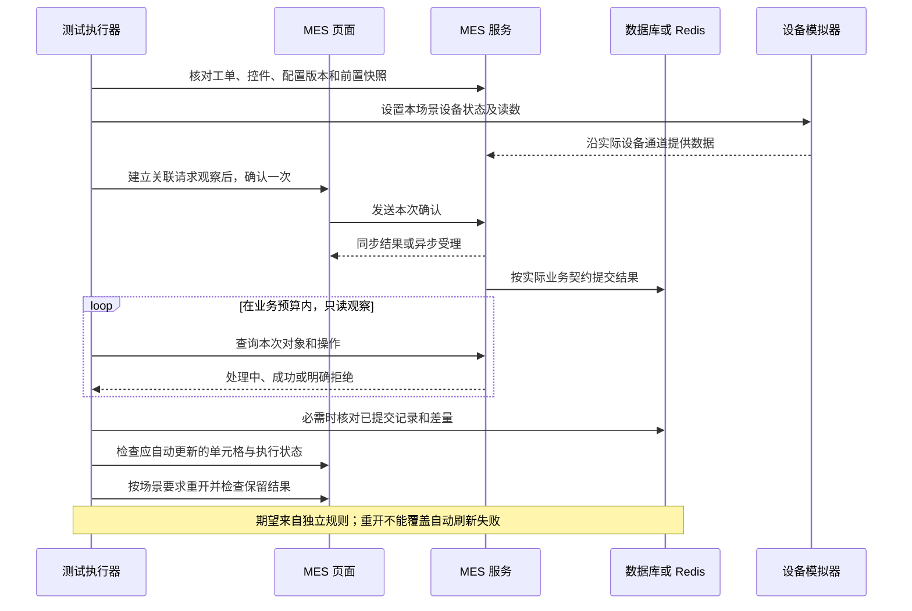

接口同步完成时，提交应满足其返回契约；图中存储时序是异步示意。没有 operation ID 就使用真实业务唯一键、版本和完成状态关联，不能假造字段。轮询回调只读，不包含保存、签名、称量确认或扣减。[Playwright 的自动断言与 expect.poll](https://playwright.dev/docs/test-assertions)

### 6.2 数量、状态与禁止副作用

称重至少区分：当前设备读数、未确认草稿、已确认明细、累计结果、变量值和库存影响。哪一步产生哪项结果须有契约，不能将“称量完成”直接等同于“扣减库存”。

| 场景 | 应明确的断言 |
|---|---|
| 未确认读数 | 页面显示本轮值；按契约不提前产生有效记录或推进步骤 |
| 确认一轮 | 指定工单/步骤/批次的有效明细、结果值和次数差量 |
| 取消当前轮 | 当前草稿按规则回退，之前有效记录按规则保留；撤销已确认记录另建场景 |
| 阈值附近 | 下限、上限、相邻最小分辨值；包含关系、先修约还是先比较、超差授权明确 |
| 拆批/移库/消耗 | 分别核对来源与目标、守恒关系、余额和流水；不共用错误的扣减公式 |
| 重复请求 | 所有尝试终结后，有效结果及业务影响的数量符合契约；尝试审计可有多条 |
| 权限/签名 | 精确签名类型、角色资格、顺序、同人限制、原因及时间；UI 限制与服务端拒绝都验证 |
| 刷新/重新登录 | 恢复规定执行状态；草稿和已确认结果采用不同规则 |

负向场景先等明确拒绝或处理终结，再检查禁止副作用；存在异步重试时按契约观察迟到结果。不能在请求尚未完成时查到零条记录就通过。多角色使用独立会话；修改浏览器时间也不能自动改变后端或 Redis 的时钟。

### 6.3 数据库与 Redis 的维护边界

数据库查询使用只读账号，封装成业务取数函数，按组织、工单、步骤、批次和操作限定；禁止查“全库最新一条”。多表采用一致的读取方式，明确主库或副本延迟，轮询避免长事务旧快照。准备优先走业务 API；隔离环境 SQL 基线仅处理前置数据，不替代受测审批、执行或签名。

Redis 按 Key 契约分别验证：缓存的新业务结果及更新/失效方式；锁的归属、处理中保护和完成后释放；权威执行状态的迁移与恢复；TTL 的允许区间。不能只在结束后看锁消失来证明曾经正确加锁。只读观察不弹出队列消息、不改变消费位置。具体表名和 Key 留在适配器内。

### 6.4 浏览器和网络异常是横切检查

在动作前建立关联观察，按方法、目标路径和业务身份匹配请求，区分提交、查询及后台轮询。对负向测试，预期拒绝不是意外故障；其他必需请求失败、业务码错误、未允许的页面异常应进入该步骤结果。

`requestfailed` 不能单独覆盖所有错误：HTTP 404/503 仍可能正常完成网络请求，因此还要检查响应状态和业务码。[Playwright Request 事件说明](https://playwright.dev/docs/api/class-request)

记录 pageerror 和相关 console error，允许名单必须具体、有原因且定期检查；不能全局忽略控制台错误，也不把所有遥测噪声自动判成业务缺陷。采用具体元素、请求和业务终态等待，避免依赖可能一直有轮询/设备消息的全局“网络空闲”。

## 7. 结果、变量写入和显示的共用策略

最有价值的抽象是三个独立问题：**得到什么结果、写入哪个实例、怎样显示。** 首版用纯函数和有限分支实现，无需策略引擎或每个规则一个类。

**图 12：数值与称重共用显示策略，各自保留业务结果规则。**

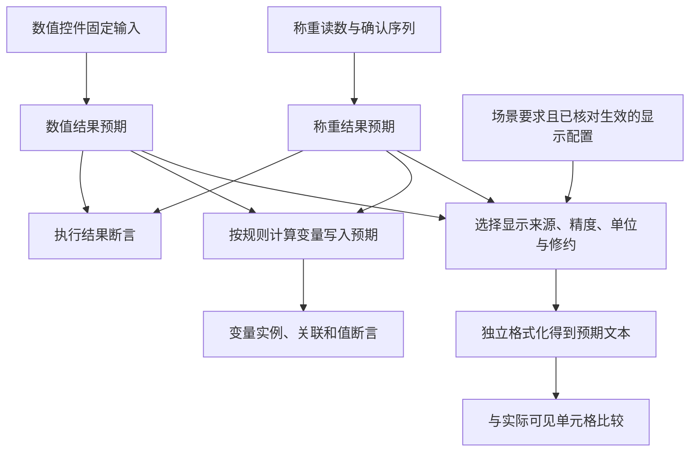

当前规则来源分为已在聊天中表述的意图和仍需确认的细节：

| 分支 | 可采用的业务意图 | 仍需核对 |
|---|---|---|
| 数值控件绑定数值变量 | 按变量精度显示；变量有单位则显示，无单位则不显示 | 固定补零、修约、分隔符；是否及何时写入变量 |
| 数值控件不绑定变量 | 数字部分按系统精度显示 | 单位规则、系统精度的来源与生效时机 |
| 称重结果写入变量，并按该变量显示 | 核对写入与变量精度/单位显示 | 结果取本轮、累计还是其他来源；对应哪个绑定字段 |
| 称重配置自定义显示及单位来源 | 页面确有这些可配置项 | 与净重输出变量的优先级；尚不自行设默认 |
| 变量精度为 0 | 0 是有效配置，不因真假值判断回退 | 精度缺失/非法时的产品行为另定 |
| 已绑定但变量查询失败 | 不能当作未绑定而切换系统精度 | 是明确业务错误还是暂时加载，应按真实契约区分 |

执行前先比较用例配置与实际生效配置，再用预期配置选策略。实际丢了变量绑定应失败，不能临时切换系统精度让用例通过。变量定义与工单/步骤下的变量实例分别定位，不按名称取“最新值”。

显示策略建议接收：预期显示值、已确定的显示来源、小数位、单位标签、修约模式及格式约定。结果与写入策略另行处理单位换算和存储精度。未确定的分支返回“规则待确认”，不偷偷回退。

假设经确认采用固定两位、四舍五入、单位前一个空格，预期值 `12.3467` 才显示为 `12.35 kg`；这是格式示例，不是当前已批准规格。存储可能仍要求 `12.3467`，应分别断言。显示比较完整文本或独立的数值/单位区域，不能转成 Number 后使 `12.300` 与 `12.3` 看起来相等。

建议用 [decimal.js](https://github.com/MikeMcl/decimal.js) 或定点整数做十进制计算；decimal.js 的 toFixed 支持显式小数位和修约模式。计算精度、存储精度、显示小数位分别配置。[官方 API](https://mikemcl.github.io/decimal.js/#toFixed)

首批参考样例包括：变量精度 0、不同于系统精度、无单位、有单位、修约边界、绑定缺失，以及称重结果正确但写错变量实例。单位显示与单位换算是两项规则；首条主链路可先使用不涉及换算的已确认配置。

## 8. 数据隔离、设备和失败证据

每次运行记录环境、产品构建、测试版本、规则/模型版本、case ID、尝试编号及实际业务 ID。运行标识只写入产品允许的编码/备注/外部关联字段；其他关联保存在测试清单中，不要求现有接口凭空支持 testRunId。

**图 13：每个场景独占可变业务数据，共享设备按资源能力串行。**

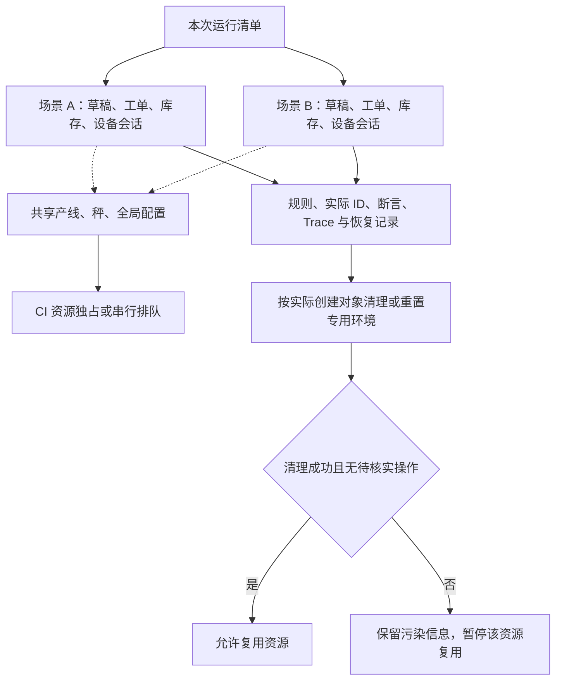

浏览器上下文只隔离会话，不隔离数据库、库存和物理设备。只读且不可变的基础数据可共享；改变全局精度、占用同一设备或修改共享库存需独占资源。先单 worker 建立稳定性，再按实际隔离能力提高并发，跨 CI 任务不能只用进程内锁。

准备、执行和清理均有时间预算。准备部分失败也记录已创建对象；先保存证据，再按授权业务入口清理。未知写入可能仍在后台运行，先核实/终结或隔离资源，不能清理后立即复用。审计或已发布记录不能删除时，采用可重建环境或专用测试租户；不清空 Redis 全库。

设备优先复用已有测试服务，在实际接入边界提供稳定值、波动、断开、延迟、拒绝及重复消息。模拟器要按场景隔离并能查询交互；WireMock 只补 HTTP 依赖，不替代 OPC 或电子秤专用协议。

报工依次观察 MES 发起、对端收到、对端业务处理、MES 接收并应用回写。过滤物料场景验证实际外发明细和未过滤对照项，不只检查页面。物理打印、真实扫码/NFC、秤精度等单列真实验收。

每条失败至少保留：规则 ID、场景输入、模型/部署版本、工单与控件实例、失败步骤、预期与实际、关联请求、必要数据快照、Trace、首次异常及恢复轨迹。报告可关联原始错误，但不能仅凭错误文案自动认定产品根因。附件不含密码、Token 或完整连接串。

| 结果分类 | 对报告和门槛的影响 |
|---|---|
| 通过 | 全部必需业务/UI 检查通过，数据生命周期符合要求 |
| 失败 | 业务不符或执行异常；保留首个失败，停止该场景后续业务动作 |
| 阻塞/未完成 | 环境缺失、必需证据不可取得、写结果未知；不算通过 |
| 未执行 | 尚未选择、尚未调度或被前置阻断，分开列出 |
| 重试后通过 | 保留首次失败并标记不稳定，不改写首轮结果 |
| 清理失败 | 单独列出；阻止污染资源复用，不能掩盖原始业务失败 |

分类使用现成测试状态、标签、附件和汇总实现；不新建运行状态服务。产品缺陷、脚本缺陷、数据冲突、环境与外部故障是后续分诊类别，最终根因仍需证据。

## 9. 基础设施和现成产品

首期依赖只覆盖执行、断言、报告和必要接入。具体版本在实施时按实际 Node、前后端和 CI 环境锁定，不在方案里虚构版本兼容性。

| 工具 | 使用方式 | 引入时机 |
|---|---|---|
| [Playwright Test](https://github.com/microsoft/playwright) + TypeScript | UI、APIRequestContext、fixtures、断言、并行与 Trace | 核心；优先统一测试语言和执行入口 |
| [decimal.js](https://github.com/MikeMcl/decimal.js) | 独立的十进制计算与显示预期 | 数值/称重策略开始时 |
| [Allure Report](https://github.com/allure-framework/allure3) 与 Playwright 集成 | 业务步骤、规则标签、附件和运行报告 | 首期；与 Trace 配合，无需自建后台 |
| 数据库官方/成熟驱动、Redis 客户端 | 只读且有范围的事实查询 | 源码确认存储类型及必要契约之后 |
| [PICT](https://github.com/microsoft/pict) | 从确认模型生成快速组合套件 | 全量数量明确、需要缩短反馈周期时；不默认替换全量 |
| 已有设备模拟器；[WireMock](https://github.com/wiremock/wiremock) | 可控设备和 HTTP 外部依赖 | 优先复用；HTTP 缺口才新增 WireMock |
| 现有 CI 和产物存储 | 调度、资源独占、报告留存 | 首条可重复链路完成后接入 |
| [Playwright Test Agents](https://playwright.dev/docs/test-agents) | 辅助规划和生成脚本、分析维护问题 | 可选建设工具；不作为正式回归的运行前提 |

Playwright 原生支持 API 准备及 UI 后查询，通常无需为测试再引入第二套 HTTP 框架。[API testing 文档](https://playwright.dev/docs/api-testing) 自动等待处理元素可操作性，业务完成仍由本方案的终态和断言定义。[Auto-waiting 文档](https://playwright.dev/docs/actionability)

Playwright Test Agents 提供 planner、generator、healer；可复用规划与生成能力。对 MES，healer 生成的修改必须评审，自动跳过失败或放宽业务断言不能成为发布通过依据。[官方 Agents 说明](https://playwright.dev/docs/test-agents)

ReportPortal、Testcontainers、Toxiproxy、fast-check、XState 等先列为扩展候选：分别到集中结果分析、按需独立环境、网络故障、复杂动作序列、复杂状态维护出现明确成本收益时再评估。首期无需同时部署它们，也无需再叠一套自主浏览器 Agent 框架。

## 10. 工程组织与维护思想

建议的目录是职责边界，文件数量随实际需求增长；不是要求一开始把所有目录填满。

```text
openspec/                     # 已安装；确认后的需求、设计、任务和规格
assets/
  rules/                      # 业务规则来源与参考样例，生成器不能自动覆盖
  models/                     # 已确认字段、取值域、约束、路径和场景参数
  generated/                  # 源码动作索引与组合清单，可按版本重生成
src/
  pages/                      # 页面及复用控件交互
  flows/                      # 业务动作、参数传递和步骤状态
  clients/                    # API、只读 DB/Redis、模拟器
  oracles/                    # 独立结果、写入、显示与副作用预期
  fixtures/                   # 数据与资源生命周期
scripts/                      # 小范围提取、枚举、覆盖核查及报告汇总
tests/                        # 按下列范围组织
  e2e/                        # 完整主链路
  config/                     # 配置保存、互斥、切换、拒绝
  execution/                  # 控件执行及显示
  integration/                # 权限、并发、存储与外部契约
  oracle/                     # 预期函数与生成器的独立参考测试
playwright.config.ts
```

源码动作索引只是可重生成的事实候选，最终执行的动作适配器经过评审。规则正文由 OpenSpec 管理时，rules 目录保留引用和参考样例，不再复制一份相互冲突的规格。场景引用规则 ID、模型版本和实际环境映射，不能直接写死生产数据 ID。

把“测试是什么”和“如何定位/取数”分开，页面调整通常修改 pages，接口和 schema 调整改 clients，显示规则变更改 oracles 及对应参考样例。避免在每条测试里复制 SQL、格式化、登录和弹框操作。

优先为生成器、精度/单位预期和恢复决策安排能发现真实错误的参考测试，例如剪枝漏解、精度 0 被回退、未知提交被重复执行。页面定位器不逐一写形式化单测，通过相应用例验证即可。

## 11. 落地阶段和验收标准

**图 14：从业务契约到可重复链路，再扩展组合覆盖。**

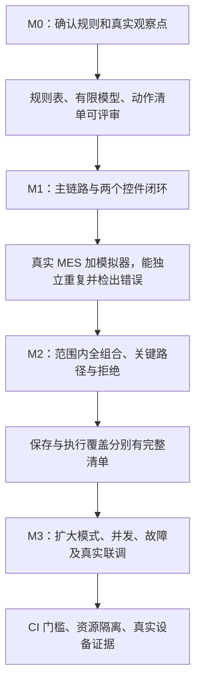

| 阶段 | 具体交付 | 必须证明 |
|---|---|---|
| M0 规则与资源核对 | 一个纵向模块的源码索引、配置模型、真实接口/数据观察点；确认显示及称量规则 | 无虚构接口、表和 Key；未确定规则显式列出，不能自动补全 |
| M1 第一版可用闭环 | 一条配置到执行的 UI 主链路；数值控件及一种称重模式的独立场景；报告与清理 | 配置版本传递正确、结果与显示独立判定、首次失败可定位、未知提交不重复 |
| M2 配置规模化 | 受控 BFS、DFS 全量、关键切换/拒绝；PICT 冒烟候选集 | 已确认有限域的全量生成正确；合法配置保存/执行与非法目标的拒绝结果分别追踪 |
| M3 风险扩展 | 更多模式/签名、库存、并发、设备异常、外部报工和真实联调 | 各层必要证据齐全；模拟与真实结果分开；资源冲突可控制 |

M1 不声称覆盖全 MES 或全部称重模式；M2 的“全量”也只对应被确认的模型范围。若某个合法配置需要尚未具备的设备/签名能力，应报告阻塞，不从合法集合移除。每阶段按交付验收，不按页面数量估算完成度。

M1 至少安排以下故障检出验证：系统精度误代变量精度、变量值错误或写错实例、后台成功但 UI 不更新、请求响应丢失后的结果核实、必需控件缺失。可以先用独立事实样例验证断言，再在受控环境注入可观测故障；两种证据分别记录。

### 运行安排

| 时机 | 推荐范围 | 明确保留的边界 |
|---|---|---|
| 提交检查 | 预期函数/生成器、受影响短场景、主链路冒烟 | 是快速反馈，不宣称全量组合完成 |
| 常规回归 | 主链路、关键迁移/拒绝、选定快速组合 | 高风险交互显式加入 |
| 专项全量 | 冻结模型及环境后的全部候选：合法配置保存/执行，非法目标验证阻止或修正 | 全部完成前持续报告未执行与阻塞；不自动降级 |
| 发布前 | 高风险范围及约定浏览器/终端，必要的真实联调 | 发布要求由既有流程明确，模拟结果不替代真实验收 |

先实测单场景准备、执行、观察和清理耗时，再估计全量成本。共享设备限制有效并发，不能简单用用例总数除以机器核数。全量清单支持分批调度；只恢复未执行或已核实可安全重建的场景，不能按“最后点击序号”盲目续跑。

## 12. 自动化能做到多高

**对规则已确认、观察点齐全、数据和设备可控制的场景，目标是从触发、准备、执行、判断、取证到清理无人工点击。** AI 辅助减少建设和维护工作；这不等于系统可以自行知道所有业务规则。

| 环节 | 自动化方式 | 人保留的职责 |
|---|---|---|
| 阅读源码和整理操作 | AI 生成候选清单与脚本草稿 | 确认真实调用关系及未解析分支 |
| 组合生成、编排和执行 | 确认模型驱动，动作库复用，固定运行策略 | 确认有限输入域、覆盖目标及高风险路径 |
| 结果、显示、存储断言 | 独立规则函数与查询适配器自动判断 | 决定业务正确性，评审规则变更 |
| 等待和恢复 | 预先登记的状态与允许动作 | 处理未知状态、结果长期不明和不可恢复资源 |
| 报告和失败分析 | 自动取证、初步分类、AI 分析建议 | 确认根因与修复，不让修复覆盖原始失败 |
| 真实设备和发布 | 自动结果提供证据 | 物理结果验收和发布决定 |

试点前不填写“80%/90% 自动化率”。实际分别测量：

- **业务规则有效覆盖**：有本版本有效运行证据的规则数 / 本阶段已确认规则数；待确认、缺失能力和阻塞另列。
- **配置覆盖**：保存、执行、快速组合、迁移和负向覆盖分别统计，且区分已检查与已通过。
- **无人工干预完成率**：准备到清理均自动完成的运行次数 / 发起次数；准确检出业务失败可算自动完成，结果不明或清理失败不算。
- **首次稳定性**：同构建和受控环境下首轮结果的可重复性；重试转绿单列。
- **负例检出与定位成本**：预设错误是否被正确断言抓到，报告到根因确认需要多少人工步骤。

这几项比“写了多少脚本”“点了多少按钮”更能判断投入是否有效。

## 13. 实施前必须确认的业务规则

架构方案可以评审；以下规则没有答案时，相应实现保持待确认，不从页面示例或源码行为直接推定。

| 事项 | 需要确认的具体答案 |
|---|---|
| 称重显示优先级 | 净重输出变量、单元格自定义显示、称量单位/变量单位共同配置时，值、精度、单位分别取何处；已发起本轮确认 |
| 数值显示细节 | 无变量时单位、固定补零、修约方式、负数/零、分隔符、精度缺失行为 |
| 输出与写入 | 称重使用本轮、累计或其他结果；数值控件是否写变量；写入时机、实例作用域和存储精度 |
| 配置及版本 | 变量/主配方/处方发布、生效和云边同步信号；工单何时冻结版本，新版本是否影响已有工单 |
| 库存语义 | 分配、称量、拆批、投料、消耗分别改变哪些数量和流水 |
| 取消和签名 | 当前草稿、已确认结果及签名各自保留/回退范围；准确签名类型、顺序和资格 |
| 约束和覆盖域 | 互斥是禁用、自动取消还是保存拒绝；合法输入范围、代表值、需要遍历的变量清单 |
| 异步和权威来源 | API/DB/Redis 各自能证明什么；可查询终态、延迟、未知写入核实与真实幂等契约 |

本轮整合不把这些待确认事项转成已批准的 OpenSpec 规格，也不提前实现恢复分支。确认后按阶段建立 OpenSpec change，把需求、设计、任务和验收证据关联起来。

## 附录 资料依据与证据边界

引用聊天用于理解自动编排、源码动作索引、显示策略、遍历和恢复的诉求；其中助手的技术建议经过取舍后才进入本稿，不当作已批准需求。相关技术能力核对了正文所链的官方文档和仓库。

| 本项目页面资料 | 对方案的具体影响 |
|---|---|
| [称重控件配置](ascii页面图/云端-配置管理/主配方设置/控件/称重控件/称重控件.md) | 四种模式、互斥/依赖候选、净重变量、自定义显示和单位来源，要求有限模型与显示优先级确认 |
| [确认净重](ascii页面图/边端-生产执行/批记录执行/控件/称重控件/称重控件-确认净重.md) | 当前读数与累计量/次数分开，禁止由读数直接推断确认落账 |
| [取消当前](ascii页面图/边端-生产执行/批记录执行/控件/称重控件/称重控件-去皮补料-取消当前.md) | 当前轮与历史结果的边界需要独立规则 |
| [签名变量配置](ascii页面图/云端-配置管理/变量管理/签名变量/新建修改详情签名变量.md) | 按准确签名类型分别建场景，不能统一折叠成单签/双签 |
| [签名展示](ascii页面图/边端-生产执行/批记录执行/控件/签名控件/签名展示.md) | 操作人和复核阶段不同，隐藏同名按钮要求局部定位 |
| [工单详情](ascii页面图/边端-生产管理/工单管理/工单详情.md) | 配方版本和关联字段验证；重复 prop 不能单独作为定位依据 |
| [库存分配](ascii页面图/边端-生产管理/工单管理/操作/分配/库存分配页面.md) | 物料、批次、子批次精确定位，建议/实际/有效数量分别判断 |
| [投料报工](ascii页面图/边端-生产执行/工单报工/工单报工-投料tab.md) | 母行与明细不能混数；报工过滤核对真实外发明细 |
| [审计详情](ascii页面图/云端-配置管理/审计追踪/审计追踪详情.md) | 关键动作关联操作者、终端、工单及前后值 |

页面资料是部分快照，一些文件为空；disabled、示例数值或缺少按钮都不能独自确定完整业务行为。具体接口、表名、Redis Key、全量用例数和工期，仍需源码与实际测试环境证据。
