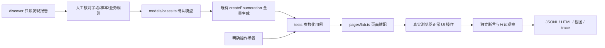

# 六页 UI 自动化执行

按用户确认的 [覆盖规格](../openspec/changes/execute-playground-ui-configurations/coverage-review.md) 生成候选，再由 Playwright Test 实际操作本项目 Vue 页面。模型版本 `2026-10-07.1`。使用本机 Chrome，每条用例使用新上下文，不使用日常浏览器的登录状态或保存数据。

## 安装与运行

需要 Node.js 20.19+、本机 Chrome，以及已经启动的练习站：

```bash
# 项目根目录；首次安装
npm --prefix packages/config-enumerator ci
npm --prefix packages/config-enumerator run build
npm --prefix automation ci

# 一个终端启动页面
npm --prefix playground run dev

# 另一个终端先生成计划，或直接执行完整计划
npm run ui:plan
npm run test:ui
```

默认 URL 为 `http://127.0.0.1:5173`，4 个并发 worker，**不重试**。运行结束退出浏览器；有失败返回非零退出码。每条测试独立，某条失败不会阻止其余测试。

```bash
# 可见窗口、每个操作减速 500 毫秒，只看 A/B/C/D 用例
npm run test:ui -- --headed --slow-mo 500 --workers 1 --grep 'category linkage.abcd'

# 仅看某个候选（标题包含模型名、版本、序号和合法性）
npm run test:ui -- --grep 'category basic.required@2026-10-07.1#105 '

# 换本项目的端口
PLAYGROUND_URL=http://127.0.0.1:5174 npm run test:ui
```

正常模式没有人为停顿，浏览器会很快；调试模式才减速。Ctrl+C 会通知 runner 清理它创建的浏览器。不按 Chrome 进程名批量退出其他浏览器。

## 覆盖范围

这里的“全量”是**每个已确认组的有限值域全量**，保留所有合法与非法候选；没有用 PICT 抽样，也没有全页面字段相乘。

| 区域 | 单份配置候选 | 分类页 + all 页 | 组的范围 |
|---|---:|---:|---|
| 基础输入 | 127 | 254 | 必填三字段组合、自由文本、数字格式、Unicode 长度 |
| 联动规则 | 52 | 104 | A/B/C/D 全部 16 种、条件输入 36 种 |
| 嵌套弹框 | 342 | 684 | 来源/变量/精度/单位/必填 320 种及输入边界 |
| 扩展输入 | 280 | 560 | 单选/级联/多选组合、日期时间、阈值、颜色、附件 |
| 动态表格 | 391 | 782 | 行内 360 种、重复编码、数量边界、1–20 行 |
| 操作场景 | — | 69 | 取消、恢复、分页、清空、键盘、导航、分区保存、全站重置 |
| **合计** | **1192** | **2453 次测试** | 2384 次候选执行 + 69 次操作场景 |

A/B 同开候选还包含 A→B、B→A 两个分支，因此完整计划共 **2461 条计划路径**。路径数不等于候选数。`passedPaths` 仅计入整个测试通过的路径，不把失败测试中尚未完整验证的路径计为通过。

全量不包括无限文本、无限操作顺序、20 行所有值互相相乘、其他 Vue 项目、真实 MES 后端。PICT 冒烟选例留待后续实现。

## 数据怎样变成测试



`npm run discover -- --plan ...` **仍只负责发现**，不会保存配置、枚举业务组合或执行本模块。发现结果不能自动推导数字边界、互斥规则、保存成功的业务条件。本次 `models/cases.ts` 来自已经确认的覆盖规格，使用已有枚举器生成用例。

接入其他 Vue 项目时，继续复用枚举算法、Playwright runner 和报告方式；另行确认该项目的模型、正常前置数据、页面适配和独立断言。当前 `pages/lab.ts` 是练习站的具体适配，不宣称只换 URL 就能测任意项目。

## 如何断言

- 正常配置：操作后核对字段、禁用/选中状态；保存后展开页面结果，核对完整配置；读取 localStorage 作补充；刷新再次核对保存结果和对应输入。
- 非法配置：核对具体错误、拒绝、截断或依赖状态。不能达到的 A/B 同开目标验证正常 UI 禁用；没有强制点击、移除 disabled、注入 Vue 状态或写 localStorage。
- 控件会规范化输入时：原始值留在候选元数据，实际值单独附在结果中；例如 101 字符被截为 100，不声称原始 101 字符保存成功。
- 日期/时间非法样本：检查原始非法值未原样保存，最终值为空或为有效日期时间。超时、找不到元素都算失败，不能冒充“非法输入被拒绝”。
- 预期不导入 `playground/src/model.ts` 的校验函数。文件输入使用测试生成的 Buffer，不读取用户文件。

浏览器上下文只能隔离本练习站的前端存储。接入共享数据库的项目，需要另行实现后端测试数据隔离。

## 查看结果

每次创建新的 `automation/output/<时间戳>-<唯一编号>/`，不覆盖先前记录：

| 文件 | 内容 |
|---|---|
| `invocation.json` | 命令参数、站点、启动时间、计划/执行模式 |
| `plan.json` | 本次完整执行清单、每个候选的目标值、分类、违规规则、路径数 |
| `results.jsonl` | 每条测试结果、持续时间、操作与断言步骤、实际页面/存储附件、错误和证据路径 |
| `summary.json` | 计划/执行/通过/失败/超时/中断/跳过/未执行数，按页面和区域汇总 |
| `html/index.html` | 可检索的 Playwright 报告 |
| `artifacts/` | 失败截图、trace、实际值附件 |

```bash
cd automation
npx playwright show-report output/<本次目录>/html
npx playwright show-trace output/<本次目录>/artifacts/<失败用例>/trace.zip
```

`classification=invalid` 是候选性质，`status=passed` 表示 UI 正确拒绝或修正了它，二者不冲突。`complete` 表示本次所选测试都实际结束；`coverageComplete` 还要求没有 `--grep` 筛选，且没有跳过、中断或未执行；**只有 `allPassed=true` 才表示全部通过**。仅 `--list` 的计划永远不算执行完成。直接调用 `npx playwright test` 时，报告标为 `direct-unverified-selection`，不宣称已执行整个确认目录；正式全量验收使用上面的 `npm run test:ui` 包装命令。

重现失败时保留旧报告，再通过 `--grep` 单独跑；没有 `test.fail()`、默认重试或跳过来隐藏已知缺陷。当前实跑结果见 [验收记录](VERIFICATION.md)。
