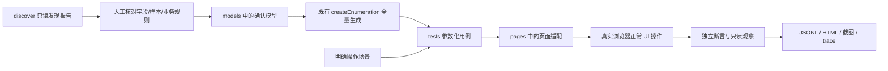

# 七页 UI 自动化执行

真实 MES 工作流已接入独立的 `--suite mes` 入口，支持当前 JSON 业务定位及独立面板断言。运行方式见 [MES 工作流自动化](MES.md)；下文仍为练习站七页的有限模型测试。

按原六页的 [覆盖规格](../openspec/changes/execute-playground-ui-configurations/coverage-review.md) 和新增 [发现验证页规格](../openspec/changes/execute-discovery-validation-page/coverage-review.md) 生成候选，再由 Playwright Test 实际操作本项目 Vue 页面。模型版本 `2026-10-11.1`。使用本机 Chrome，每条用例使用新上下文，不使用日常浏览器的登录状态或保存数据。

## 安装与运行

需要 Node.js 20.19+、本机 Chrome，以及已经启动的练习站：

```bash
# 项目根目录；首次安装
npm --prefix packages/config-enumerator ci
npm --prefix packages/config-enumerator run build
npm --prefix automation ci

# 一个终端启动页面
npm --prefix playground run dev

# 另一个终端先生成计划，或直接执行完整计划
npm run ui:plan
npm run test:ui

# 只执行发现验证页的完整目录（212 条）
npm run ui:plan -- --scope discovery
npm run test:ui -- --scope discovery
```

默认 URL 为 `http://127.0.0.1:5173`，4 个并发 worker，**不重试**。运行结束退出浏览器；有失败返回非零退出码。每条测试独立，某条失败不会阻止其余测试。

```bash
# 可见窗口、每个操作减速 500 毫秒，只看 A/B/C/D 用例
npm run test:ui -- --headed --slow-mo 500 --workers 1 --grep 'category linkage.abcd'

# 仅看某个候选（标题包含模型名、版本、序号和合法性）
npm run test:ui -- --grep 'category basic.required@2026-10-11.1#105 '

# 换本项目的端口
PLAYGROUND_URL=http://127.0.0.1:5174 npm run test:ui
```

正常模式没有人为停顿，浏览器会很快；调试模式才减速。Ctrl+C 会通知 runner 清理它创建的浏览器。不按 Chrome 进程名批量退出其他浏览器。

## 覆盖范围

这里的“全量”是**每个已确认组的有限值域全量**，保留所有合法与非法候选；没有用 PICT 抽样，也没有全页面字段相乘。

| 区域 | 单份配置候选 | 执行次数 | 组的范围 |
|---|---:|---:|---|
| 基础输入 | 127 | 254 | 必填三字段组合、自由文本、数字格式、Unicode 长度 |
| 联动规则 | 52 | 104 | A/B/C/D 全部 16 种、条件输入 36 种 |
| 嵌套弹框 | 342 | 684 | 来源/变量/精度/单位/必填 320 种及输入边界 |
| 扩展输入 | 280 | 560 | 单选/级联/多选组合、日期时间、阈值、颜色、附件 |
| 动态表格 | 391 | 782 | 行内 360 种、重复编码、数量边界、1–20 行 |
| 操作场景 | — | 69 | 取消、恢复、分页、清空、键盘、导航、分区保存、全站重置 |
| **原六页小计** | **1192** | **2453 次测试** | 2384 次候选执行 + 69 次操作场景 |
| 发现验证页 | 204 | 212 | 单独入口：6 个配置组 + 8 个操作场景 |
| **当前七页合计** | **1396** | **2665 次测试** | 2588 次候选执行 + 77 次操作场景 |

A/B 同开候选还包含 A→B、B→A 两个分支，因此完整计划共 **2673 条计划路径**。路径数不等于候选数。`passedPaths` 仅计入整个测试通过的路径，不把失败测试中尚未完整验证的路径计为通过。

发现验证页覆盖原生输入、两层 Teleport、6 个开放 Shadow 根、6 个子文档、5 类列表、扫描预算和显示证据。它没有保存功能：检查取消/刷新恢复默认、字段不串扰、没有业务写请求或 localStorage 写入；列表只验证已实现的展示和翻页。闭合 Shadow 内部、虚拟列表剩余窗口及未实现的确认/选中不在范围内。

原生禁用单位 t 核验 disabled/selected 状态；当前 Chrome 无头原生菜单不能可靠通过键盘操作，selectOption 又可越过 disabled，因此不以该 API 注入非法值，也不宣称系统菜单点击拦截已验证。

全量不包括无限文本、无限操作顺序、20 行所有值互相相乘、其他 Vue 项目、真实 MES 后端。

## PICT 冒烟（支持 n-way）

已接入真实微软 PICT：组内合法 n-way，加违规规则代表、有限样本/边界和全部操作场景。原有全量命令保持不变。

```bash
npm run pict:install                       # 首次安装，项目根目录
npm run ui:smoke:plan -- --way 2           # 只生成并核验清单，不打开浏览器
npm run test:ui:smoke -- --way 2           # 生成并执行
npm run test:ui:smoke -- --way 3           # 三阶覆盖

# 仅发现验证页，同样支持任意 N
npm run ui:smoke:plan -- --scope discovery --way 2
npm run test:ui:smoke -- --scope discovery --way 2
npm run test:ui:smoke -- --scope discovery --way 3
```

N 默认为 2；字段不足 N 的组使用全部字段的强度。每次生成 `冒烟选例说明.md`、`smoke.json` 和原始 PICT 证据，并复用中文报告。冒烟通过不表示全量配置覆盖完成。完整说明见 [PICT 冒烟指南](SMOKE.md)。

## 数据怎样变成测试



`npm run discover -- --plan ...` **仍只负责发现**，不会保存配置、枚举业务组合或执行本模块。发现结果不能自动推导数字边界、互斥规则、保存成功的业务条件。`models/cases.ts` 和 `models/discovery.ts` 来自各页明确的覆盖规格，使用已有枚举器生成用例。

接入其他 Vue 项目时，继续复用枚举算法、Playwright runner 和报告方式；另行确认该项目的模型、正常前置数据、页面适配和独立断言。当前 `pages/lab.ts` 是练习站的具体适配，不宣称只换 URL 就能测任意项目。

## 如何断言

- 正常配置：操作后核对字段、禁用/选中状态；保存后展开页面结果，核对完整配置；读取 localStorage 作补充；刷新再次核对保存结果和对应输入。
- 非法配置：核对具体错误、拒绝、截断或依赖状态。不能达到的 A/B 同开目标验证正常 UI 禁用；没有强制点击、移除 disabled、注入 Vue 状态或写 localStorage。
- 控件会规范化输入时：原始值留在候选元数据，实际值单独附在结果中；例如 101 字符被截为 100，不声称原始 101 字符保存成功。
- 日期/时间非法样本：检查原始非法值未原样保存，最终值为空或为有效日期时间。超时、找不到元素都算失败，不能冒充“非法输入被拒绝”。
- 预期不导入 `playground/src/model.ts` 的校验函数。文件输入使用测试生成的 Buffer，不读取用户文件。

浏览器上下文只能隔离本练习站的前端存储。接入共享数据库的项目，需要另行实现后端测试数据隔离。

## 查看结果

每次创建新的 `automation/output/<时间戳>-<唯一编号>/`，不覆盖先前记录：

| 文件 | 内容 |
|---|---|
| `中文测试报告.md` | 中文结论、通过/失败/中断/未执行统计、逐页面场景汇总和失败入口；建议先看这份 |
| `中文失败报告.md` | 非通过用例的中文设计步骤、预期与实际、影响、截图、trace 和原始错误 |
| `invocation.json` | 命令参数、站点、启动时间、计划/执行模式 |
| `plan.json` | 本次完整执行清单、每个候选的目标值、分类、违规规则、路径数 |
| `results.jsonl` | 每条测试结果、持续时间、操作与断言步骤、实际页面/存储附件、错误和证据路径 |
| `summary.json` | 计划/执行/通过/失败/超时/中断/跳过/未执行数，按页面和区域汇总 |
| `html/index.html` | 可检索的 Playwright 报告 |
| `artifacts/` | 失败截图、trace、实际值附件 |

这两份中文报告在每次运行结束时自动生成，计划模式和能正常收尾的 Ctrl+C 中断也会生成。报告由代码读取执行证据生成，不需要 Agent 或大模型。原始英文页面快照和技术错误保留；HTML 报告本身仍为 Playwright 原生界面。

已有运行可以离线补生成（**不会重新执行测试**），在项目根目录运行：

```bash
npm run ui:report:zh -- --run "automation/output/<本次目录>"
```

也可在 automation 目录运行 `npm run report:zh -- --run "output/<本次目录>"`。相对路径均相对于命令当前目录；重复执行只更新两份中文 Markdown。

失败报告将“场景设计步骤”与“实际执行记录”分开：没有执行到的步骤不能视作已完成。已知断言会提取中文预期和实际；未知错误保留原文并明确要求排查，不根据用例名猜根因。截图下方可展开实际步骤和收尾时的字段值。中断或未执行表示覆盖未完成，不自动归为产品缺陷。缺少 summary 或统计不一致会提示证据不完整；损坏 JSON 会以中文错误退出。

中文场景目录在 `reporting/catalog.mjs`，新增用例时同步补充名称、设计步骤与预期说明。通用生成器在 `reporting/chinese-report.mjs`；单元检查为 `npm run test:report`（automation 目录）。这些说明不参与执行断言，断言仍来自测试脚本与已确认规格。

```bash
cd automation
npx playwright show-report output/<本次目录>/html
npx playwright show-trace output/<本次目录>/artifacts/<失败用例>/trace.zip
```

`classification=invalid` 是候选性质，`status=passed` 表示 UI 正确拒绝或修正了它，二者不冲突。`complete` 表示本次所选测试都实际结束；`coverageComplete` 还要求范围为整个项目 `catalogScope=all`，没有 `--grep` 筛选，且没有跳过、中断或未执行；**只有 `allPassed=true` 才表示全部通过**。仅 `--list` 的计划永远不算执行完成。直接调用 `npx playwright test` 时，报告标为 `direct-unverified-selection`，不宣称已执行整个确认目录；正式全量验收使用上面的 `npm run test:ui` 包装命令。

`--scope discovery` 的完整运行使用 `scope=page-confirmed-catalog`，以 `pageCoverageComplete` 标记该页执行完整，`coverageComplete` 始终为 false。默认 `--scope all` 执行七页。`--grep` 是调试筛选，不等于单页完整验收。

发现页失败报告增加 Frame/Shadow 宿主链、字段实际值和单元格显示/业务值；采集失败会记录附件，不掩盖原始测试失败。

重现失败时保留旧报告，再通过 `--grep` 单独跑；没有 `test.fail()`、默认重试或跳过来隐藏已知缺陷。当前实跑结果见 [验收记录](VERIFICATION.md)。

发现验证页本轮全量与 2-way/3-way 实跑证据见 [新页验收记录](../openspec/changes/execute-discovery-validation-page/verification.md)。原 [验收记录](VERIFICATION.md) 是旧六页历史运行，不能代表新增目录已执行。
