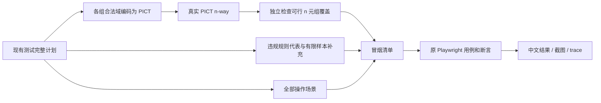

# PICT n-way 冒烟

保留现有全量执行，新增真实微软 PICT 冒烟。它从现有已确认候选中选例，复用原有 Playwright 操作和断言，不需要 Agent 或大模型。

## 安装与使用

在项目根目录执行。本机已安装项目内 PICT；换机器首次使用时先运行安装命令。

```bash
# macOS/Linux：需要 Git、make、C++ 工具链；安装到 automation/.tools/pict
npm run pict:install

# 只生成并核验 2-way 冒烟清单，不打开浏览器
npm run ui:smoke:plan

# 3-way 清单
npm run ui:smoke:plan -- --way 3

# 启动练习站（另一个终端）
npm --prefix playground run dev

# 生成、核验并执行 2-way 冒烟
npm run test:ui:smoke

# 3-way 执行；可见窗口、操作减速
npm run test:ui:smoke -- --way 3 --headed --slow-mo 300 --workers 1

# 调试冒烟中的某个场景（报告会注明只执行筛选范围）
npm run test:ui:smoke -- --way 2 --grep 'behavior.table.add-clear-query-goto-end'

# 仅发现验证页的完整范围
npm run ui:smoke:plan -- --scope discovery --way 2
npm run test:ui:smoke -- --scope discovery --way 2
npm run test:ui:smoke -- --scope discovery --way 3

# 原命令默认七页全量
npm run ui:plan
npm run test:ui
```

`--scope` 支持 `all`（默认七页）和 `discovery`（仅新增发现验证页）。生成、预核对和执行使用同一个范围，清单和中文报告均记录 `catalogScope`。旧版缺少范围的冒烟清单需重新生成。

`--way N` 接受安全范围内的正整数，默认 2。也支持 1-way；每组实际强度为 `min(N, 字段数)`。例如只有两个字段的组在 3-way 下会覆盖该组全部合法组合。N 大于字段数不是非法参数，但不会变成跨组组合。`--way` 不能用于默认全量命令；通用写法为 `npm run test:ui -- --suite smoke --way 3`。

Windows 或已有 PICT 的机器可以指定可执行文件，跳过项目内编译：

```bash
PICT_BIN=/absolute/path/to/pict npm run ui:smoke:plan -- --way 2
```

Windows 可在 PowerShell 设置 `$env:PICT_BIN`。自定义二进制同样记录 SHA-256，并接受输出解析和覆盖核验。没有 PICT、编译失败或生成失败均返回非零退出码，不使用近似抽样替代。

项目安装固定为微软 `v3.7.4`，源码提交 `d529bb1535b725c8f29704f183b23dd344895d02`；源码标签与提交必须一致。只修改本项目 `.tools` 目录；macOS 编译时仅为本次子进程补充 SDK 标准库头路径，不修改系统配置。重复安装核对原二进制指纹，不覆盖不匹配的既有安装。

## 怎样选例



1. 自动调用现有测试的 `--list` 收集完整目录，不操作页面；不复制另一套字段、样本和合法性规则。
2. 同一候选在分类页和全部组件页共用选例结果，两个入口都保留。空串、Unicode、多选数组、附件对象等映射成 `P0/V0` 标识，映射文件保存原始类型和值。
3. 从完整合法候选构建合法值域，把域内禁止的完整元组转成 PICT 约束；固定使用种子 1。不会先生成后删除非法行，以免漏掉其他合法组合。
4. 独立投影所有合法候选的 n 元组，要求 PICT 输出全部覆盖；未知值、非法行、重复行或缺失组合立即报错。
5. 每条违规规则选择一个代表，优先只违反该规则；无法隔离时记录实际违规集合。随后补齐每个字段的每个已确认有限样本，保留边界和非法专用输入。这里只保证规则代表和单字段样本，不保证所有非法字段组合。
6. 保留全部明确操作场景，例如取消、恢复、分页、导航和重置。非法候选继续通过正常 UI 验证拒绝/修正，不能绕过禁用状态注入数据。
7. 操作浏览器之前核对完整冒烟的注册清单。执行时再次核对候选模型指纹，模型变化时要求重新生成。

“全量”与 n-way 都限于已确认的有限样本，不能覆盖无限输入或无限操作顺序。当前多选标签的一个子集是一个因子取值；n-way 不会擅自把标签拆成新的布尔因子。

## 查看计划和结果

每次使用独立 `automation/output/<时间戳>-<编号>/`：

| 文件 | 含义 |
| --- | --- |
| `冒烟选例说明.md` | 中文分组覆盖、选中配置、原因、违规规则和保留的操作场景；建议先看 |
| `smoke.json` | 完整选例清单、原候选 ID/值、指纹、引擎身份、静态覆盖数据 |
| `pict/group-N/model.pict` | 本组实际传给 PICT 的模型及约束 |
| `pict/group-N/mapping.json` | P0/V0 与业务字段、真实值的映射 |
| `pict/group-N/output.tsv`、`stderr.txt`、`command.json` | 原始 PICT 输出、日志、参数与退出码 |
| `plan.json` / `results.jsonl` / `summary.json` | 本次实际选择、操作结果和统计 |
| `中文测试报告.md` / `中文失败报告.md` | 明确标识冒烟范围与执行结果，保留截图与 trace |
| `catalog/`、`preflight/` | 完整目录收集及执行前核对的只列计划记录 |
| `generation-error.json` | 如果生成阶段失败或中断，记录原因与是否已进入 UI 执行阶段 |

全非法组不调用 PICT，只有映射与清单中的负向补充记录，不伪造模型输出。

- `verified`：选例满足静态 n-way/补充目标，不表示页面通过。
- `complete`：本次所选用例执行结束；失败也可以是执行结束。
- `smokeComplete`：整个冒烟清单执行结束，不能存在筛选、跳过、中断或未执行。
- `allPassed`：本次所选用例全部通过；需结合范围理解。
- `coverageComplete`：专指七页完整确认目录；冒烟运行始终为 false。
- `pageCoverageComplete`：仅发现页分组全量完整执行时为 true；冒烟始终为 false。

出现同一缺陷影响两个页面入口时，会有两条失败用例；不等于两个独立缺陷。不会为让冒烟变绿而自动跳过或修改断言。

## 维护与复用

核心 `smoke/pict.mjs` 接收框架无关的有限候选列表，包含 `id`、`values`、`classification`、`violations`；`smoke/selection.mjs` 对接本项目测试清单。其他 Vue 项目可复用选例核心，但仍需自己的已确认模型、页面适配和断言，不能仅换 URL。

本实现先读取完整有限目录，再让 PICT 压缩。每组最多 100000 个候选、20 个字段，覆盖核验最多 200 万次投影；超限明确报错，避免耗尽内存。它适合当前模型规模，不作为巨大模型的流式约束求解器。

```bash
npm --prefix automation run test:smoke   # 使用真实 PICT 的单元与集成检查
npm --prefix automation run test:report
npm --prefix automation run typecheck
```

PICT 上游：[官方仓库](https://github.com/microsoft/pict)、[固定版本文档](https://github.com/microsoft/pict/blob/v3.7.4/doc/pict.md)。本次生成数量与浏览器实跑证据见 [验收记录](../openspec/changes/add-pict-nway-smoke/verification.md)。

发现验证页的有限域包括输入、Teleport、Frame、开放 Shadow、列表及扫描预算；原生禁用选项只核验禁用状态，未实现的确认/列表选中不计为保存覆盖。新页独立全量和 2-way/3-way 实跑结果见 [新页验收记录](../openspec/changes/execute-discovery-validation-page/verification.md)。上述旧 PICT 验收记录保留为历史证据。
