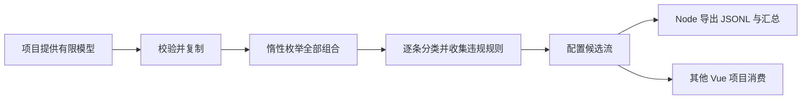

## Context

用户确认全量为有限候选值中的全部组合，包括业务非法组合；非法组合后续仅通过正常 UI 验证阻止或自动修正。当前交付先实现枚举算法，可被不同 Vue 项目使用。

## Goals / Non-Goals

**Goals:**
- 同一 JSON 模型可在 Node 和浏览器使用，核心无 Vue、Element Plus、DOM 或 Node 内置模块依赖。
- 所有组合都输出；非法结果记录全部违规规则，合法结果也不等同于 UI 已可达或已执行。
- 对大空间采用惰性枚举、精确计数、明确的预算和取消结果。

**Non-Goals:**
- 本轮不实现页面自动发现、路径编译、Playwright 执行、存储注入或接口测试。
- 不实现 PICT 或冒烟选例；以后独立生成候选集，共享字段和规则模型。
- 不穷举任意字符串或日期；候选值由接入项目明确提供。

## Decisions

1. **独立包和声明式模型。** `packages/config-enumerator` 输出 ESM JavaScript 与 TypeScript 类型；Node 命令行与浏览器核心分离。字段候选值允许 JSON 数据，规则采用固定的比较、逻辑、包含和长度运算，不执行模型中的代码。相对于把逻辑放进 Vue 组件，这使其他 Vue 2/3 项目可通过模型复用。
2. **迭代式深度优先枚举笛卡尔积。** 按字段及候选值的输入顺序，末字段变化最快。使用索引向量避免递归深度限制。不按业务规则剪枝，否则会漏掉本次要求的非法组合。每个完整组合检查所有规则，返回规则标识和中文原因。
3. **模型错误与非法配置分离。** 空值域、重复字段/候选值、未知字段引用、未知运算符和非 JSON 数据属于模型错误，枚举前拒绝。违反正确规则的组合属于正常输出，不抛出异常。
4. **流式输出与完成状态。** 核心返回单次消费的迭代器和统计快照。组合总数及计数内部使用 BigInt，JSON 输出十进制字符串。预算、取消和提前停止不冒充完整枚举。模型复制后使用，调用方修改源模型或输出值不能改变后续结果。
5. **标识和审计。** 用例标识由模型 id、版本和顺序号组成；修改字段、候选值顺序或规则必须更新版本。CLI 同时导出模型快照、SHA-256、逐行 JSON 和汇总，避免跨模型混淆。不把分类结果命名为测试通过。
6. **输出文件隔离。** CLI 创建新目录且拒绝覆盖已有目录；先校验模型再写入。完整导出退出码 0，未完成为 2，输入或 I/O 错误为 1，中断为 130。磁盘写入失败不留下宣称完整的清单。

## Risks / Trade-offs

- 全量数量指数增长 → 提前提供精确总数，流式消费，预算结果明确未完成；不自动切换冒烟。
- 有限模型可能漏掉真实业务规则 → 示例仅为接入方式，真实项目维护并确认模型；生成器不声称自动理解任意页面。
- 数字/字符串或日期语义不同 → 不做类型隐式转换；日期以已确定的候选值或允许集合建模，不推断业务时区。
- 大批量同步枚举会占用主线程 → Node CLI 周期让出事件循环；Vue 批量生成建议放 Worker，示例小模型可以直接消费。
- 非法组合可能有多种拒绝路径 → 保留违规规则列表，本轮不推断先后操作或生成具体 UI 断言。

## Migration Plan

新增独立目录和文档入口，不改变现有 Vue 应用依赖或存储。通过本地 npm 打包及临时独立 Vue 工程构建验证复用；不发布 npm 包或部署。

## Open Questions

本轮枚举范围已明确；后续页面发现、操作路径和冒烟策略另行实施。
