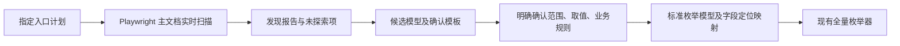

## Context

用户已确认只读扫描及指定入口展开，不允许切换业务选项或保存；发现后先输出待确认模型，不直接枚举。主要验收必须使用本项目 Vue 练习站。

## Goals / Non-Goals

**Goals:** 读取运行页面的真实控件及状态，支持原生/ARIA 控件及必要 Element Plus DOM 适配；通过独立子路径避免污染零依赖枚举核心；保留观测来源、入口失败和范围限制；确认后复用已有枚举 API。

**Non-Goals:** 自动推导已批准业务规则、无限 BFS、遍历所有业务操作、选择业务选项、保存、文件上传、存储注入、跨 iframe/封闭 Shadow DOM 自动扫描及自动穷尽虚拟列表。

## Decisions

1. 在 `@mes-ui/config-enumerator/discovery` 增加 Playwright 页面观察 API，扫描通过 DOM/ARIA 而非 Vue 内部实例。Playwright 为可选 peer，CLI 使用安装的浏览器；核心入口不依赖它。
2. 入口计划由项目指定 URL、就绪定位和展开步骤。步骤仅允许打开下拉、激活标签页和打开弹框，带预期可见定位。禁止点击 submit、业务单选/复选框、开关、选项和保存/删除等动作；不使用 force。每个场景从 URL 重新加载，在独立上下文测试。
3. 读取控件类型、标签、当前值、disabled/readOnly/required、DOM 限制、定位依据及观察到的选项。选项标签不能推定业务值；隐藏/禁用不直接变成业务约束。radio 按组整理，复合控件的内部输入尽量去重。密码值不采集。
4. 范围有界：显式场景、最多快照数、控件/选项/文本上限、超时与取消。未探索场景、禁用入口、定位歧义、截断、iframe/Shadow DOM、虚拟/远程选项均记录限制，不声称发现整个应用。
5. 输出 `report.json`、`report.md`、`draft-model.json`、`review-template.json`。草稿带包装和待确认标识，不能被枚举器误当成批准模型。确认模板需绑定本次报告指纹，显式确认范围、取值和规则；选中的字段提供有限值域和业务规则后才生成标准模型与定位映射。
6. CLI 创建新目录且不覆盖已有报告；发现和确认与枚举命令分离。失败/部分扫描保留已获取证据并返回非零；确认子命令不打开浏览器。

## Risks / Trade-offs

- DOM 元数据不足 → 标注未知值和待确认项，不读取 Vue 私有状态补成权威答案。
- 页面自动保存 → 只执行指定的展开动作不能保证第三方页面绝无写入；入口计划必须选择测试环境中无业务写入的入口。
- 动态 id/重复标签 → 优先唯一 testid、稳定 id，再使用明确标为结构性定位的 CSS；无法可靠定位时提示人工补标识。
- 草稿覆盖不完整 → 人工确认只针对显式选定的发现范围，保留报告来源，不升级为整个系统的完整发现。
- 内层变量弹框依赖切换单选 → 在当前允许范围内报告入口禁用，不为了打开它改变业务配置。

## Migration Plan

增加独立子路径、可选依赖、CLI、项目计划和文档；既有枚举 API 保持兼容。测试使用本项目实际页面与局部合成边界页面，全部运行在隔离上下文中。
