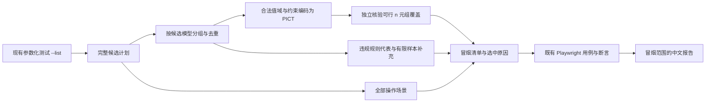

## Context

当前配置用例注册时已经枚举全部有限候选并记录 values、classification、violations；69 条操作场景独立注册。直接复用完整计划能避免复制模型和业务约束。当前本机没有 pict，但有 CMake 与 C++ 工具链。

## Goals / Non-Goals

**Goals:** 真实 PICT 选例；任意正整数 N，逐组记录实际强度；独立验证合法 n 元组覆盖；保留负向代表与样本边界；计划、执行、中文报告贯通。

**Non-Goals:** 不做跨组/跨页面笛卡尔积，不推导新业务规则，不自动修复页面，不用跳过掩盖已有缺陷，不以冒烟替代全量验收。

## Decisions

1. 运行包装先在独立 catalog 子目录执行 `--list`，不启动浏览器；读取完整清单生成 smoke.json，再正常执行被选中的配置用例与所有操作场景。保留原候选 ID、分类和两个入口，不复制测试代码。
2. 选例核心接收有限候选列表，不依赖 Vue 或 DOM。空串、中文、换行、数组、对象统一映射为 P0/V0 等标识，值的原始类型保存在映射文件中。合法候选定义可行域；将其域内的非法完整元组作为 PICT 排除约束，避免“先生成再删非法行”破坏覆盖。
3. 每组使用 `/o:min(N,字段数)`，固定种子；无合法配置的组明确记录此事实并走负向补充，不伪造 PICT 输出。保存二进制指纹、模型、原始 TSV 和映射。缺少 PICT 时中文报错，不偷偷降级到自写抽样。
4. 独立覆盖检查器从完整合法候选投影所有可行 n 元组，核对 PICT 选中合法行覆盖全部目标。检查缺失元组、未知值、重复或非法行；失败则阻止执行。
5. 补充策略：逐违规规则选择一个代表，优先只违反该规则，无法隔离时记录实际违规集合；再确保每个字段的每个已确认样本至少出现一次，优先较少违规的候选。这样边界与非法专用样本不会被遗漏；不声称覆盖全部非法组合。单字段组等价保留全部样本。
6. 执行时核对分组候选指纹，拒绝模型漂移。报告保留 full-confirmed-catalog 原含义，增加冒烟范围和 smokeComplete；冒烟即使通过，coverageComplete 仍为 false。筛选执行或中断也不得声称整个冒烟完成。
7. PICT 安装到项目忽略目录，固定微软源码提交，提供 `PICT_BIN` 自定义路径；不改全局环境。子进程无 shell 拼接，有超时和输出上限，信号只转发本次拥有的子进程。

## Risks / Trade-offs

- [先枚举的规模上限] → 本轮复用已确认有限目录；不是面向无限/巨大模型的约束求解器，记录候选规模并设计算量保护。
- [冒烟不是最少用例] → PICT 是启发式压缩，补充边界/负向/行为后会增大；输出实际数量和组成。
- [同样 N 在不同组强度不同] → 清单和中文覆盖说明逐组列出 requestedWay、effectiveWay、可行与已覆盖元组数。
- [报告误称全量] → 对全量/冒烟/筛选/计划/中断分别测试，禁止冒烟设置全量覆盖完成。

## Migration Plan

新增本地安装与冒烟命令，原有 `npm run test:ui`、`npm run ui:plan` 继续默认全量。通过新增开关接入，撤回开关即可使用原模式。已有报告不重写。

## Open Questions

无。用户已确认组合范围、负向补充和执行报告范围；具体命令与文件组织按上述工程选择实施。
