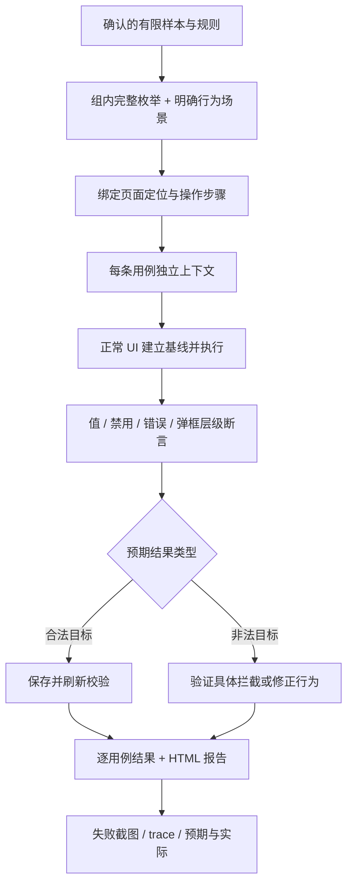

# 六页 UI 自动化执行规格（已确认）

日期：2026-10-07。已确认范围：本项目六个页面全部组件。用户已确认采用下面的分组全量、有限样本和断言。本文是实现前规格，不是已执行报告。

## 1. 已确认的组合方式

采用“有关联的字段在组内全量组合，独立控件遍历全部已列样本，再补操作顺序场景”。所有组均在各自分类页和 `/#/all` 各执行一遍；`/#/all` 另外验证五区共存、草稿共享、分区保存和全站重置。

**这是明确列出的分组全量，不是同一页面全部字段的笛卡尔积，也不是任意操作序列穷举。**报告必须声明组合粒度、值域版本、计划数和实际执行数；不能用“全部组件覆盖”代替“全部跨字段组合覆盖”。

例如扩展页的候选数量为：

| 因子 | 候选数 |
|---|---:|
| 优先级 | 3 |
| 车间/产线（含空） | 4 |
| 四个功能标签的全部子集 | 16 |
| 日期区间样本 | 7 |
| 提醒时间样本 | 6 |
| 日期时间样本 | 7 |
| 告警开关 × 阈值 | 2 × 21 |
| 颜色样本 | 3 |
| 文件样本 | 21 |

若要求这些字段全部相互组合，仅扩展页就有 `3×4×16×7×6×7×2×21×3×21 = 149,361,408` 条原始候选，尚未乘以操作顺序及两种页面展示。已确认的分组方式为表中这一区域生成 278 条配置/输入候选；再加下面明确列出的 -1/101 阈值边界，共 280 条，在两种展示下共 560 次执行，另加清空、搜索等行为场景。分组方式已经由用户确认，不改变覆盖强度。

下面所有“其余字段固定为合法基线”的基线都通过正常 UI 建立。允许后续用浏览器读取 DOM 和当前上下文存储做断言；禁止写 localStorage、改 Vue 状态或通过脚本设置 DOM 值来绕过 UI。

## 2. 基础输入 `/#/inputs`

| 组 | 明确候选 | 预期断言 |
|---|---|---|
| 必填组合 | 名称：空、三个空格、`UI配置`；整数：空、`0`、`1`、`9999`、`10000`；重量：空、`0`、`0.001`、`1.234`、`100000`、`100000.001`、`1.`；三者全组合 105 条 | 合法时保存并刷新回显；空名/越界/不完整数字逐项显示错误，已保存快照不变。其余自由文本、备注固定合法基线 |
| 自由文本 | 空、中文英文数字、`'\"<>&`、带换行的文本 | 单行 input 的换行处理需按浏览器输入语义记录；其他字符不得无故丢失；保存和刷新结果一致 |
| 整数格式拒绝 | `-1`、`1.2`、`1e3`、`abc`、`１２`、`+1` | 先用 UI 设置合法值 7，再尝试非法输入；仍为 7，显示整数格式提示 |
| 小数格式拒绝 | `-0.1`、`1.2345`、`1e3`、`abc`、`１２.３`、`+1` | 先设置 1.234，非法输入后保留此前合法值并显示格式提示 |
| 备注长度 | 空、99 个 a、100 个 a、101 个 a、50 个 `中😀`、50 个 `中😀` 加“尾” | 按 Unicode 码点计算；超限截到 100，不能破坏表情；保存的是处理后的值，同时记录原始输入与实际值 |
| 只读与禁用 | 只读编码、禁用设备输入 | readOnly/disabled 属性正确；正常键盘操作不改变值。不能以强制赋值来“测试” |
| 页面行为 | 脏标记；全部必填同时错误；保存后修改再恢复；未保存刷新回退 | 恢复/刷新得到之前保存值；结果区与草稿区别可观察 |

数字候选按字符串保存，避免测试器把 `1.` 或指数形式先转成普通数字而改变测试含义。备注的 DOM 没有 maxlength，断言以输入处理结果为准。

## 3. 联动规则 `/#/linkage`

| 组 | 明确候选 | 预期断言 |
|---|---|---|
| A/B/C/D | 16 个布尔组合全部保留，沿用已确认的 9 合法、7 非法 | 合法目标正常配置、保存、刷新；A/B 同开目标分别验证 A→B、B→A 两种禁用路径；C=true、D=false 验证自动选 D 且锁定。双重违规必须分别核对两条约束 |
| 条件输入组合 | 模式 system/manual × 手动值（空、三个空格、37）× 高级开关 off/on × 原因（空、三个空格、调试验证），全组合 36 条 | 先在可编辑模式设置目标草稿，再切到目标模式；系统模式下手动值禁用但保留；高级关闭时原因禁用但保留；启用时对应空白字段禁止保存 |
| 解除与恢复 | 取消 A 恢复 B；取消 B 恢复 A；取消 C 后 D 保留并恢复；先选 D 再选 C；手动→系统→手动保留草稿；高级开→关→开保留原因；恢复已保存 | 同时核对值和 enabled/disabled，不能只检查样式颜色 |

单条非法候选可展开为多个操作分支；报告同时统计候选数量和实际路径数量，不能混算。任意分支未执行或失败，该候选不能标为全部通过。

## 4. 嵌套弹框 `/#/dialogs`

| 组 | 明确候选 | 预期断言 |
|---|---|---|
| 名称 | 空、三个空格、`UI控件` | 空白禁止外层保存；合法名称保存、刷新、重新打开均一致 |
| 来源与显示组合 | 来源场景：固定值 10、变量模式未选择、V-001 至 V-008，共 10 种；× 精度 0/1/2/3 × 单位 空/kg/g/件 × 必填 false/true，共 320 条 | 切换 source 后固定值和变量入口互相禁用；未选择变量禁止保存；全部 8 个变量需跨分页真正点选；精度、单位和必填设置保存回显 |
| 固定值边界 | 与基础重量的 7 个保存样本相同 | 固定模式才校验该值；失败停留外层弹框且显示错误 |
| 固定值格式 | 与基础小数的 6 个非法格式样本相同 | 保留最后合法输入，显示格式提示 |
| 配置说明 | 与备注的 6 个长度样本相同 | 100 码点限制和保存结果一致 |
| 搜索分页 | 编码、中文名称、单位、无结果、清空搜索；第二页→搜索后回第一页；跨页选择 | 查到对应变量；空结果提示；分页不丢失当前选择 |
| 内层生命周期 | 无选择确认禁用；选择后确认；选择后取消、X、Escape；点击遮罩 | 确认只改外层草稿；取消/X/Escape 丢弃内层修改且外层仍开；遮罩不关闭 |
| 外层生命周期 | 内层确认后，外层确认/取消/X/Escape；切换分类页；切换全部组件页；点击遮罩；关闭后重开 | 只有外层确认写入；其他退出丢弃外层及已确认的内层草稿；遮罩不关闭；关闭后重开读保存值 |
| 模式往返 | 固定→变量→固定、变量→固定→变量 | 不活动来源的草稿保留，禁用状态与目标模式一致 |

变量自身精度/单位属于列表元数据，**当前控件选择变量时没有自动覆盖显示精度/单位**。本轮按两套配置分别验证，不能推导“绑定变量后自动同步显示配置”。当前是两层弹框，第三层弹框不在实例中。

## 5. 扩展输入 `/#/extended`

| 组 | 明确候选 | 预期断言 |
|---|---|---|
| 三种选择组合 | 优先级 normal/high/urgent × 车间空/一号配料/一号包装/二号灌装 × 称重/复核/记录/签名的 16 个子集，共 192 条 | 逐个正常 UI 选择；只选一个优先级；级联父子对应；多选值、标签、计数一致；保存并刷新 |
| 日期区间 | 空；2026-10-07 同日；10-07 至 10-08；10-31 至 11-01；2026-12-31 至 2027-01-01；反向区间；包含 2026-02-30 的非法区间，共 7 个样本 | 正常区间保存原日期；清空为空；非法原始区间不得原样成为保存结果，记录控件拒绝/规范化的实际分支。至少有一条通过日历点击产生合法区间 |
| 提醒时间 | 空、00:00、12:34、23:59、24:00、12:60，共 6 个样本 | 合法值按 HH:mm 保存；非法值不得原样保存；清空及滚轮/列表选择均验证 |
| 日期时间 | 空、2026-10-07 00:00:00、2026-10-07 23:59:59、2028-02-29 12:34:56、2026-02-29 12:34:56、2026-10-07 24:00:00、非日期文本，共 7 个样本 | 合法本地字符串不转 UTC；非法原始值不得原样保存；分别验证直接输入、日历选日、时分秒选择、确认和清空 |
| 告警与阈值 | 开关 off/on × 0,5,10,…,100，共 42 条 | 先开启并设置值再切到目标开关；关闭后滑块与数值输入都禁用且值保留；正常保存刷新；方向键每步增减 5 |
| 阈值补充边界 | -1、101 | 通过可编辑数值控件输入；不能保存界外值。手工数值输入是否接受非 5 的倍数，不擅自增加新业务限制；本轮全量候选使用已声明的 5 步长 |
| 颜色 | #13665d、#000000、#ffffff | 通过正常输入控件可用的交互选择；值、颜色展示、保存及刷新一致。原生系统弹层若无法通过浏览器自动化驱动，必须报告受阻，不能用 JS 改值冒充 UI 操作 |
| 文件 | 不选文件；6 种扩展名 txt/csv/json/png/jpg/jpeg × 大小 0/2MiB/(2MiB+1)；另加大写 .CSV 和非法 .exe，共 21 个样本 | 通过文件输入控件选择临时测试文件；大小或后缀不合法显示错误并保留上次合法文件元数据；合法值保存元数据；刷新显示元数据但原生文件 input 不伪造已选文件 |
| 其他交互 | 下拉切换覆盖前值；多选搜索/逐项取消/清空/键盘/Escape；级联清空；日期/时间清空；文件移除；恢复已保存 | 搜索只过滤不取消已选项；清空只作用目标字段；移除不等于保存；恢复得到保存快照 |

文件样本由测试工程在临时目录生成，不读取用户文件。日期使用固定样本避免随今天改变；UI 日历按明确年月定位。非法日期/时间的具体错误文案未在练习站声明，不虚构必然出现的文案，也不接受仅凭 timeout 判通过。

## 6. 动态表格 `/#/table`

| 组 | 明确候选 | 预期断言 |
|---|---|---|
| 单行配置 | 编码 空/三个空格/MAT-010/前后空白包围 MAT-010 × 名称 空/三个空格/物料 X × 数量 0.001/1/1.234/99999.999/100000 × 单位 kg/g/件 × 启用 false/true，共 360 条 | 另一行固定合法基线；先启用设置数量单位再切目标开关；编码名称必填；保存去首尾空白；关闭仅禁用数量单位；保存刷新保留每行配置 |
| 重复编码 | 完全相同、大小写不同、首尾空白不同 × 同页/跨页，共 6 条 | 校验全部行；拒绝保存并定位到首个错误所在页，原保存快照不变 |
| 数量输入边界 | 空、0、-1、100000.001、abc，共 5 个样本 | 控件拒绝或规范化后，实际值与行为单独记录；不可保存非法数量，不能把归一化后的值冒充原始输入已保存 |
| 行数 | 1 至 20 的每一种行数，共 20 条 | 新增由 UI 完成，新行按实际 UUID 定位，填写合法内容后保存刷新核对行数和内容；20 行禁止新增，1 行禁止删除；0/21 行通过禁用边界验证 |
| 删除确认 | 取消、确认、X、Escape、遮罩 | 仅确认删除草稿行；保存前已保存结果不变；取消保持草稿；遮罩不关闭 |
| 搜索/分页 | 编码、名称、大小写、首尾空白、无结果、清空；1→2 页→1；搜索后回第一页；新增清空搜索并定位末页；删除后页码收敛 | 只读筛选不丢行或改配置；跨页编辑不串行；搜索隐藏的非法行仍被保存校验发现 |
| 恢复 | 已保存→增改删草稿→恢复 | 行数据恢复到保存快照，同时清空搜索/错误并回第一页 |

本方案全量遍历列出的单行取值及 1–20 行行数，**不穷举 20 行之间所有独立取值组合**。多行相互影响通过重复编码、跨页校验和增删行为场景覆盖；若要求每行与每行全相乘，需另选更大组合范围。

## 7. 全部组件页与公共交互 `/#/all`

所有上述参数化用例和所属区域交互用例均在 `/#/all` 复跑，按 section 限定选择器，防止同名保存/恢复按钮点错区域。弹框仍限定最上层可见 dialog。

另外覆盖：

1. 六个导航入口和站点首页链接；页面标题、当前导航、区域显示正确。
2. 五个快速定位按钮及各区返回顶部，验证目标区域进入视口/获得焦点。
3. 每个分类页编辑未保存值，导航到 all，再返回；草稿和值保留且没有额外保存。
4. 五区均有合法草稿时，只保存一区，读取五区保存结果并刷新；只有目标区更新，其他区恢复其原保存数据。
5. 分别展开五个“查看配置数据”，与可见保存结果、刷新结果一致；只观察，不修改状态。
6. 已通过 UI 保存五区后，重置弹框的取消/X/Escape 保留数据；确认恢复初始值并清除本站保存结果；测试发生在独立上下文中。
7. 分类页和 all 导航离开打开的二层弹框时关闭弹框；重新进入后读已保存配置。

额外的存储损坏注入、禁用存储故障注入、多浏览器并发、系统输入法内部候选窗、生产环境和真实 MES 后端不属于本次六页正常 UI 回归。

## 8. 执行与结果记录

- 正常模式无固定停顿；调试模式提供可见窗口和每步停顿，结束后自动关闭本次浏览器。
- 每条记录包含 caseId、模型/值域版本、route、目标值、输入尝试、实际值、预期分类、规则、步骤、断言和执行结果。
- `classification=invalid` 不等于 `status=failed`；正常 UI 正确阻止非法状态时测试通过。
- 用例失败继续执行其他独立用例。定位失败/环境不可用不能标为业务拦截成功；报告明确 failed、timedOut、未执行及取消。
- 默认不重试来掩盖首次失败。结果报告包含 planned/attempted/passed/failed/notRun，部分执行不能标记全量完成。
- 读取 localStorage 只用于此纯前端实例的补充持久化断言；主要断言仍为可见 UI、保存结果和刷新回显，不连接数据库或 Redis。
- 预期值和规则独立维护，不在测试时调用 `playground/src/model.ts` 的校验函数算期望。

## 9. 确认记录

2026-10-07，用户确认：“采用评审稿的分组全量、有限样本和断言（推荐）”。模型版本 `2026-10-07.1`；后续实现和报告必须遵循本文范围，不将分组全量称为跨页面笛卡尔积全量。
