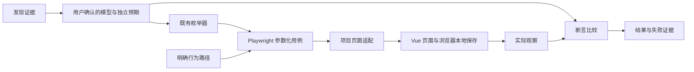

## Context

用户已要求开发并执行本项目六页的 UI 自动化。现有 `discover` 是有界只读观察器，`config-enumerate` 是框架无关的配置候选生成器；它们均没有完整业务执行与断言层。五个分类视图在 all 页复用同一实例，保存位置是当前浏览器上下文的 localStorage。

六页覆盖规格和拟议有限样本见 `coverage-review.md`。2026-10-07 用户明确确认分组全量、有限样本和断言。实现使用模型版本 2026-10-07.1。

## Goals / Non-Goals

**Goals:** 使用 Playwright Test 操作所有现有组件；合法配置保存并刷新回显，非法输入及目标验证正常 UI 的实际拦截；每条有来源、步骤、断言、结果及失败证据；全部组件页与分类页均覆盖。

**Non-Goals:** 自动猜测业务规则、只给 URL 就自主穷尽应用、全站所有字段跨区域相乘、无限文本或无限操作顺序穷举、使用 PICT 代替本轮确认的覆盖、注入非法应用数据、连接真实 MES 后端。单页所有字段相乘已明确不采用。

## Decisions

1. 新建独立 `automation/` 项目，使用与项目 Playwright 对齐的 `@playwright/test`。共享候选生成仍在 `packages/config-enumerator`，不把业务页面类、断言或报告依赖放入枚举核心。明确的参数化测试可复用枚举结果，现成 runner 提供执行、隔离、步骤与报告，不再自己实现测试调度器。实现时核对当前依赖并固定版本。
2. 模型与业务适配分开：有限值域及固定独立预期在 `models/`；定位、正常 UI 操作和读取在 `pages/`；场景与规则断言在 `tests/`。不设计可运行任意代码的 JSON DSL，也不把规则名无条件映射成通用 UI 行为。
3. 将已确认的配置组交给现有枚举器，全部候选都进入测试计划；输入格式、取消和操作顺序等行为使用明确样本与路径。原始输入、处理后实际值及执行状态分开，不能把输入被截断后保存成功当作原始非法配置成功保存。
4. 每条测试使用独立上下文，通过 UI 设置合法前置数据。context isolation 在本纯前端站点隔离 localStorage；迁移到有共享后端的 Vue 项目时必须提供额外数据隔离方案，不宣称该策略足够隔离数据库。
5. 合法用例检查控件状态、保存结果和刷新回显；非法用例检查具体规则，及应保持不变的保存快照。只读 DOM/localStorage 观察允许；不 force 点击、不删除 disabled、不写存储、不调用 Vue 私有实例设置业务值。测试失败不自动修改业务实现。
6. 相同组件在分类页/all 两种路由参数下执行；定位限定所属 section，Teleport 弹框单独限定可见 dialog。表格定位使用真实行 ID，分页控制仅用于到达对应行。
7. HTML 与 JSON 报告保留每条参数及步骤；失败保留截图和 trace；中断、超时与未执行计入覆盖缺口。默认 retries=0，避免重试把首次失败藏掉。可见窗口/每步停顿是调试选项，不改变断言等待机制。浏览器由 runner 生命周期关闭。

## Risks / Trade-offs

- 全页面笛卡尔积过大 → 将数学总量和分组方案交用户明确选择，不静默采样、截断或换成 PICT。
- 组件自动规范化输入 → 分开记录尝试值与实际值，预期类型细分为接受、拒绝、截断、联动或保存校验。
- 原生颜色弹层、输入法或依赖浏览器实现的时间处理 → 验证正常 UI 可达路径，无法覆盖时如实报告受阻；不注入 DOM 绕过后声称是 UI 测试。
- 预期与实现同源 → 只把源码用于核对已实现行为和定位，正式断言来自用户确认的规格，不导入生产校验函数。
- 端口已有其他页面 → 执行前验证站点身份、标题和关键控件；测试目标必须显式指定，默认本项目回环地址。
- 其他 Vue 项目差异 → 候选算法和 runner 可复用，页面适配、值域和业务预期需分别配置。本轮只对本项目实测结果负责。

## Open Questions

无待定规格。用户已确认六页全部组件及 coverage-review.md 的分组组合方式和有限样本。

## References

- 参数化组织方式：[Playwright Parameterize tests](https://playwright.dev/docs/test-parameterize)。
- 报告输出机制：[Playwright Reporters](https://playwright.dev/docs/test-reporters)。
- 失败复现证据：[Playwright Trace viewer](https://playwright.dev/docs/trace-viewer-intro)。
