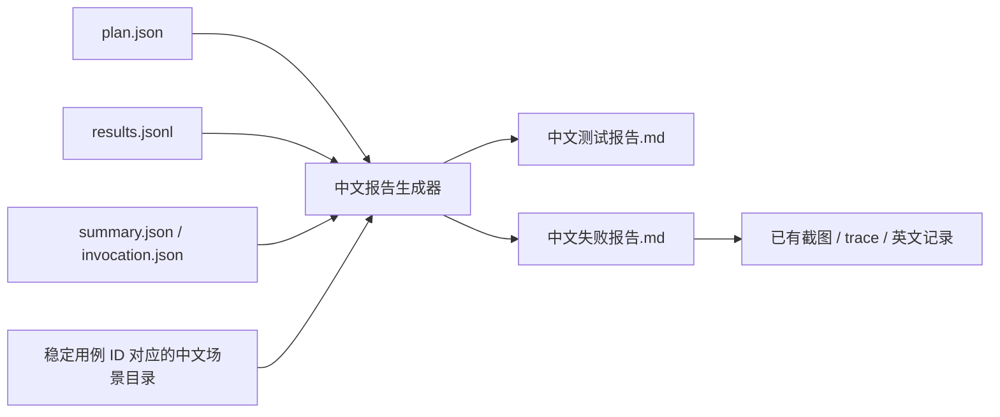

## Context

现有自定义报告器已记录计划、用例结果、步骤、实际页面附件和汇总。用户需要无需 Agent 解释即可阅读的中文入口；本次指定运行存在失败、中断和未执行，必须如实保留。

## Goals / Non-Goals

**Goals:** 每次自动生成两份中文 Markdown，并支持仅读取既有产物补生成；明确步骤、检查点、预期、实际、影响和证据。

**Non-Goals:** 不改页面、断言或选例模型，不调用 LLM，不翻译 Playwright HTML 内部资源，不推测真实 MES 业务后果。

## Decisions

采用可由 Node 直接执行的纯报告模块，避免新运行时和依赖。报告器 onEnd 写入原始汇总，onExit 等全部报告器完成后与离线 CLI 共用中文生成模块，确保 HTML 链接已就绪。

场景目录提供设计目的与计划步骤；执行结果及错误才是实际事实来源。常见 Playwright 断言按类型提取检查目标、预期、实际，保留原文便于追溯。仅在错误签名匹配时给出针对性影响解释，不根据用例名称猜失败原因。未识别错误、中断、缺少证据均明确标注。

报告按页面与场景汇总，失败/超时/中断单独展开详情，附候选值、已记录步骤、实际页面字段以及原始文件链接。非法候选测试通过表示预期拦截/修正有效。所有文本进行 Markdown 转义，附件使用相对于运行目录的路径。

已有 summary 与逐条结果核对；缺少汇总、结果不齐或不一致则标记证据不完整。损坏 JSON 不静默忽略，以中文错误退出，保留原始产物。仅允许输出两个新增文件。

## Risks / Trade-offs

- [Playwright 错误格式改变] → 未识别内容降级为中文排查说明并保留原文，不宣称已知根因。
- [新增用例没有中文目录项] → 使用明确的未登记提示；对当前全量目录做覆盖检查。
- [强制终止未执行 onEnd] → 支持离线补生成，缺少 summary 时不宣称完整通过。
- [目录维护成本] → 描述按场景组复用，关闭/导航等参数化场景使用小型模板，不建立新的执行 DSL。

## Migration Plan

集成报告器，增加补生成命令，回填指定运行。回退只需移除中文生成调用；既有原始结果始终保留。

## Open Questions

无。范围已获用户确认。本地验证不构成真实 MES 或设备验收。
