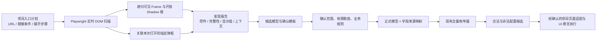
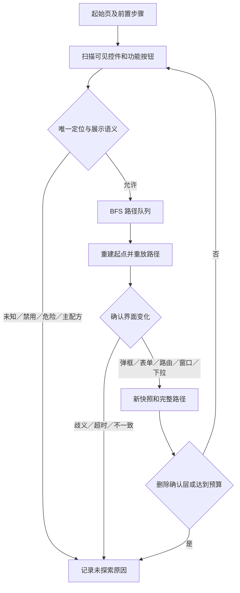

# 页面自动发现

本模块读取运行页面的 DOM，不需要导入被测项目的 Vue 源码。原生表单和 ARIA 控件按通用语义识别，Element Plus 的下拉、日期、级联、数字输入和滑块补充 DOM 适配；现场 iView/md 的下拉封装、单选组、复选框也按已识别组件边界归一。支持按指定入口展开，也支持显式开启有界自动探索；隐藏在业务选项后面的状态留待后续明确测试。



本项目的执行层已实现在 [automation/](../../automation/README.md)。它使用原六页和发现验证页各自明确的分组模型及页面适配，不直接把 `draft-model.json` 当成执行计划。`discover` 负责观察及展开入口，不填写、保存配置，也不执行这些 UI 用例。

## 用本项目实例运行

先在 `playground/` 运行 `npm run dev`，使练习站可通过 `http://127.0.0.1:5173/` 访问。以下命令在 `packages/config-enumerator/` 执行：

```bash
npm ci
npm run build
mkdir -p output
npm run discover -- --plan examples/playground-discovery.json --out output/my-discovery
# 四类发现能力的独立验证页
npm run discover -- --plan examples/discovery-evidence.json --out output/my-evidence
```

默认启动已安装的 Chrome，使用新的隔离浏览器上下文，不连接你的日常浏览器或读取其会话。可加 `--headed` 观察过程。若使用 Playwright 自带 Chromium，先执行 `npx playwright install chromium`，再加 `--channel chromium`；也支持 `--channel msedge`。

输出目录必须是新目录，每次运行保留独立报告。发现退出码：`0` 指定计划完成，`2` 部分发现，`130` 取消，`1` 参数/输出错误。示例计划故意包含一个默认禁用的“选择变量”入口，预期退出码为 **2**，不是整个命令没有结果。

| 产物 | 内容 |
|---|---|
| `report.json` | 计划、逐场景状态、逐状态控件快照、内容指纹、范围限制 |
| `report.md` | 便于阅读的入口结果与候选字段清单 |
| `draft-model.json` | 同一路由内合并的候选字段、逐状态观测、建议取值、待确认项 |
| `review-template.json` | 默认不选任何字段，三个确认项均为 false |
| `ui-model.json` | UI 元素身份、逐状态观察、包含/浮层/选项/已验证打开关系及证据 |
| `ui-model.md` | 中文关系摘要与覆盖缺口 |

元素关系模型支持查询控件属于哪个表单或记录行、入口打开了哪个界面，并与候选配置字段建立来源映射。它保留完整 URL、Frame、Shadow 上下文，不从同名或 test-id 的任意前缀推断关系，也不自动生成业务规则。实现依据、数据结构及 API 见 [UI 元素关系模型](UI-MODEL.md)。

原六页计划仍覆盖基础输入、联动、扩展控件、弹框标签页、表格和全部组件页：12 个场景、20 个快照，默认禁用的内层变量入口保持未探索。

新增 `/#/discovery`“发现验证”页，计划 `examples/discovery-evidence.json` 覆盖 10 个场景、21 个快照：两层 Teleport、无关同名弹框、分页/虚拟/远程选项、同 URL 的兄弟 Frame、嵌套和跨源 Frame、嵌套开放 Shadow 根、Shadow 内 Frame、显示格式。它已独立接入 UI 执行：新增 204 条配置 + 8 条操作场景，默认目录从原六页 2453 条增加到七页 2665 条。根目录 `npm run test:ui -- --scope discovery` 执行新页全部 212 条，`npm run test:ui:smoke -- --scope discovery --way 2` 生成并执行真实 PICT 冒烟，自动生成中文报告。详见 [覆盖规格](../../openspec/changes/execute-discovery-validation-page/coverage-review.md)。发现命令本身仍只负责观察。

上述两个指定计划没有点击新增表格行、业务选项、保存、确认或上传。远程实例真实 GET 本项目静态 JSON；这不是连接真实 MES 的接口验收。

## 入口计划

不需要列出每个字段，只需指定页面就绪条件及允许展开的入口。例如：

```json
{
  "schemaVersion": 3,
  "id": "my-vue-editor",
  "limits": { "maxSnapshots": 30, "timeoutMs": 5000 },
  "scenes": [{
    "id": "editor-dialog",
    "url": "http://127.0.0.1:5173/#/discovery",
    "ready": { "selector": "[data-testid=discovery-ready]" },
    "scope": { "selector": "[data-testid=discovery-editor]" },
    "steps": [{
      "kind": "open-dialog",
      "target": { "selector": "[data-testid=open-evidence-dialog]" },
      "expected": { "selector": "[data-testid=evidence-dialog]" }
    }, {
      "kind": "open-dialog",
      "target": { "selector": "[data-testid=open-inner-evidence]" },
      "expected": { "selector": "[data-testid=inner-evidence-dialog]" }
    }]
  }]
}
```

每个场景先离开原文档再加载 URL，清除 Vue 未保存的界面状态，避免连续同路由扫描沿用前一次弹框；上下文内的登录和已保存存储保留。初始页面和每个成功展开步骤各记录一份快照。不同场景可复用相同前缀，构成多个观察分支；未开启 exploration 时只执行指定步骤；开启后运行下述有界 BFS。

| 设置 | 说明 |
|---|---|
| `ready` | 唯一且可见的就绪元素地址；异步页面应选择业务区已加载的标志 |
| `scope` | 可选，默认 body；初始扫描根必须唯一且可见；弹框打开后自动加入扫描范围，可继续读取背景已禁用的场景 |
| `framePath` | 从主文档到场景所在 Frame 的 iframe 地址数组，省略表示主文档 |
| `open-dropdown` | 打开指定下拉、级联或日期选择入口，采集已渲染选项 |
| `activate-tab` | 激活 role=tab 的指定标签页 |
| `open-dialog` | 点击指定按钮并等待可识别的弹框 |
| `target` / `expected` | 入口及目标的精确根内地址；弹框的 expected 必须是 dialog / role=dialog 根 |

选择器歧义、禁用入口、越界操作、超时会记入报告；不会 force 点击。默认预算：60 快照、每快照累计 300 控件和 300 单元格、每字段 100 选项、文本 500 字符、每次定位/导航等待 5 秒、每快照 20 个文档（含扫描起点）、Frame 深度 4、开放 Shadow 深度 8。预算或截断不能标为完整发现。Ctrl+C 在当前有界动作结束后停止后续动作并尽量导出已有结果。

起始场景需要指定；自动探索按展示语义识别入口。仅凭按钮名字无法证明另一个系统的打开动作没有副作用；会自动创建服务端草稿或自动保存的页面应排除，随后使用项目专用规则。工具不会主动调用业务写接口或应用存储写 API。

## 自动识别入口并增加扫描深度

第八个练习页 `/#/entries` 包含新增弹框、新建页面、同名行修改／详情、独立窗口、只读统计、标签页、下拉、嵌套弹框及删除确认层。它是发现实例，本轮没有加入原七页配置全量／PICT 目录。

在 `packages/config-enumerator/` 运行：

```bash
npm run build
npm run discover -- --plan examples/entry-exploration.json --out output/my-auto-discovery
# 对已有计划开启自动探索；URL / ready / scope 仍来自已有计划
npm run discover -- --plan examples/playground-discovery.json --out output/my-deep-discovery --auto-explore --max-depth 5 --max-actions 200
```

`exploration: {}` 即开启，默认最大深度 4、动作预算 100、界面稳定窗口 300ms。`--max-depth` 范围 1..16；`--max-actions` 范围 1..2000。动作预算包含分支前置步骤重放；`limits.maxSnapshots` 为全部场景共享上限。深度是**自动展开动作数**：新增→标签页→高级配置为 3，Frame 和 Shadow 嵌套另算。计划中显式 `steps` 是起点前置路径，不计入自动深度。



| 入口 | 自动处理 |
|---|---|
| 新增、新建、添加、修改、编辑 | 打开表单；可以进入相同来源的路由或新窗口 |
| 详情、查看、预览、展示、展开、配置、更多 | 尝试打开展示界面；没有可确认变化时记录阻止原因 |
| 语义标签页、下拉、日期面板 | 展开观察；不选择选项、不填写业务值 |
| 保存、提交、确认、启用、撤销、导出等 | 只采集，不点击 |
| 其他未知按钮／未知图标 | 只采集，说明无法确认其展示语义 |
| 删除 | 默认不点击；仅下面明确配置的确认层允许打开，确认层是终点 |

名称识别支持相应常见英文词；采集链接、summary、按钮及 menuitem，使用 title/aria-label 和少量明确图标类补充现场图标。不会根据任意 class 猜测功能，也不会用行号拼装 XPath。具有 `data-row-key` 的行把修改按钮绑定到该业务行；固定列没有可靠行键时不按第 N 行合并。`controls[].row` 记录行上下文，单元格仍保留原始显示证据。表单／只读详情由命名区域补充展示文本，不用同名字段字典覆盖前一个值。

**删除契约示例**（目标和 expected 也支持 anchor / shadowPath；iframe 使用 framePath）：

```json
"exploration": {
  "maxDepth": 4,
  "maxActions": 180,
  "excludeNames": ["主配方"],
  "excludeUrlIncludes": ["mode=recipe"],
  "confirmationEntries": [{
    "target": { "selector": "button[aria-label=\"删除物料 A\"]" },
    "expected": { "selector": "[role=\"alertdialog\"][aria-label=\"删除确认\"]" }
  }]
}
```

此契约表示你已确认该按钮仅打开此弹框。程序核对其从不可见到可见，记录后停止；不点击弹框内任何后续按钮。它不能撤销一个实际上直接删除数据的错误配置。原生 JavaScript confirm 不作为可扫描 DOM 弹框。未配置的其他删除按钮仍不点击。

默认在入口名称、文档标题、可见标题中排除“主配方”，并支持排除 URL 片段；iframe 的排除结果记录在 `documents`。隐藏在无语义路由里的主配方必须补充其实际 `excludeUrlIncludes`，不能声称知道所有系统的路由命名。排除范围先于自动动作判断。

每条分支重新进入场景并重放已发现路径，**不会点击取消或后退猜测恢复状态**。同一上下文保留登录 Cookie 和存储，不忽略 URL 的 query/hash；`id=A` 和 `id=B` 是不同编辑页面。CLI 默认仍用隔离上下文；现场通过 SDK 传入已登录的 Page 即可复用登录，但重建文档会丢弃未保存的界面草稿。只关闭本次动作打开的窗口，调用方已有窗口保留。

报告新增“自动探索路径”“页面及列表操作入口”。`report.json` 的 `exploration.results[].path` 包含来源 Page URL、Frame 地址、唯一目标、目标界面；快照的 `path` 与它对应。`steps + path` 是操作路径证据，**不是自动确认的业务测试用例**。无变化、多个弹框、错误确认层、异源跳转、路径重放不一致、深度／动作预算不足均记录，报告状态为 partial；按策略跳过的按钮单列展示。候选字段仍须确认有限值域和规则才能进入枚举器。

## 无唯一 ID 时怎样定位

定位顺序为：**稳定属性 → 精确名称/标签 → 父子或兄弟语义关系 → 明确未定位**。每个候选都会回查，只有在所在 Document/ShadowRoot 中唯一命中原目标才输出地址。稳定属性包括 testid、非已知动态 ID、name 和业务字段键；动态组件 ID、当前输入值、序号、绝对 DOM 层级不作为生成依据。

例如页面和弹框都有“分组”：先识别“变量编辑”弹框，再在其中找到“分组”字段容器，最后查找容器内的下拉组件。组件没有自身标签时，可以由带标签的子节点反查组件，或由同层兄弟的精确语义识别。兄弟顺序不参与定位。

名称即使当前全局唯一，也优先绑定可唯一识别的所属区域，避免新弹框出现同名元素后地址漂移。分页跳转等明确组件类型可以作为父容器锚点，匿名 div 层级不能作为锚点。

生成的 `selector` 有两种：稳定 CSS，或 `anchor=` 开头的 JSON 步骤。步骤仅有 `descendant / ancestor / sibling`，配合组件类型与精确 `name / text`。它们由扫描器生成，用同一内核解析，**不能把 anchor 字符串直接交给 page.locator**：

```ts
const frame = await enterFrames(page.mainFrame(), field.context.framePath, 5000)
const element = await findElement(frame, field.locator)
if (!element) throw new Error('目标已不存在，停止当前步骤')
try {
  // 根据已确认的组件适配执行操作；复合控件地址指向组件根。
} finally {
  await element.dispose()
}
```

入口计划也支持 anchor 地址；不要手写很长的关系链。低层 `resolveDomElement` 的序列化参数为 `{ resolve: address }`，一般直接用 `findElement / waitElement` 即可。

`nth-child / nth-of-type / first-child / XPath 序号 / 绝对层级` 会被拒绝；运行时多匹配直接报错，绝不取第一个。**稳定 CSS、ID 和语义关系地址都先排除隐藏节点，再判断唯一性**。自身或任意祖先的 `hidden`、`aria-hidden=true`、`inert`、`display:none`、`visibility:hidden/collapse`、`opacity:0`、`content-visibility:hidden` 都会使目标不可匹配。开放 Shadow 沿宿主与 slot 追溯，跨源/嵌套 Frame 由 Playwright 逐层检查 iframe 入口。

隐藏副本不参与唯一性判断，多个可见副本仍报歧义。已经生成的地址在目标或父区域隐藏后，`findElement` 返回空；`waitElement` 等待目标及入口可见后才成功，超时则失败。没有隐藏节点绕过选项。指定弹框尚未打开时不会匹配，打开后可以按同一地址等待；模态弹框隐藏原编辑区时，仍扫描本次已关联的可见弹框。

可见但 `disabled` 的控件仍会被记录，保留禁用状态；复合组件的隐藏代理 input 不作为独立定位目标，但可由可见组件读取其当前状态。上述可见性过滤不等于“当前在视口内”或“未被其他窗口遮挡”，实际点击仍由 Playwright 检查可操作性。标签、业务属性变更后仍可能失效，工具不会承诺任意改版都能自动修复。

找不到可靠地址时，保留 `basis: unresolved, unique: false, selector: ""` 和原因，报告列出“未定位控件”，发现状态为 partial。它们不能进入候选模型/确认映射。单元格即使未定位仍保留显示证据，但不能回放。不要为追求字段数量而强行使用序号兜底。

“不要重复定位”的处理：重叠扫描区域先按 DOM 节点去重；已识别下拉/日期/数字组件的外壳、内部输入和隐藏代理只记一个控件；单选按钮汇总到唯一组容器。真实独立子输入保留。地址与候选查询缓存在单次扫描内复用，多个快照的同一稳定字段合并到一个候选字段。缓存不跨重新渲染：下一次操作仍应重新解析地址，不能长期复用旧 ElementHandle。

## 四类发现证据

### 弹框关联

先验证目标弹框不存在或不可见，点击指定入口，再等待该目标可见且具有弹框根语义。记录 `associations`：入口、目标、名称、步骤、父弹框、Frame 上下文及 `hidden-to-visible` 转换。

扫描范围是“原 scope + 本场景已关联的弹框”。因此 Vue Teleport 到 body 的内容可被采集，范围外无关弹框不会混进来。弹框令原编辑器变为 inert 或 aria-hidden 时，仍读取已关联的可见弹框。若 scope 本来就是 body，已有弹框可以作为当前页面事实被观察，但不会冒充本次操作打开的弹框。已可见目标、歧义定位、错误根、禁用入口均停止该入口并报告。关联基于指定目标及可见性变化，不推断任意同名“确定”按钮属于哪个窗口。

Element Plus 的 `data-testid` 可能落在没有 dialog 角色的内部容器，本项目使用 `[role=dialog]:has(> [data-testid=control-dialog])` 定位真实弹框根。

### 选项完整性

每个有选项的字段保存 `optionCoverage`，包含状态、来源、观测数、声明总数及原因。**只表示当前集合的证据，不证明整个系统的业务全集。**

| 状态 | 判定依据 | 实例 |
|---|---|---|
| `complete` | 原生 select 全部 DOM options；或自定义选项的 aria-setsize 一致且位置完整覆盖 1..N，未加载、未截断 | 原生 3/3、自定义 5/5 |
| `partial` | 明确还在加载、仅观察到声明总数的一部分，或预算截断 | 分页 2/5、虚拟片段 3/100、远程加载中 |
| `unknown` | 没有足够一致的总数/位置证据，不能证明完整 | 只见 2 项却不知道总数、矛盾声明 |

不会自动翻页、滚动穷尽、切换搜索条件或把多次快照的集合拼成全集。远程列表等待什么由 `ready` 决定；若加载完成才允许采集，应提供相应就绪标志。对于完整配置枚举，仍应确认受控数据集或有明确终止条件的遍历结果。草稿保留逐快照证据，不能用最后一次 complete 抹掉其他状态的 partial。

### Frame 和开放 Shadow DOM

地址格式统一为 `{ "selector": "...", "shadowPath": ["宿主1", "宿主2"] }`。selector 只在自己的 Document / ShadowRoot 中查询；shadowPath 逐层进入开放根，默认空数组。每段都要求唯一，**不使用全局自动穿透定位去猜同名元素**。

```json
{
  "framePath": [{ "selector": "[data-testid=frame-one]" }],
  "target": {
    "selector": "[data-testid=shadow-open]",
    "shadowPath": ["[data-testid=frame-shadow]"]
  }
}
```

这是地址片段；完整场景还需 URL、ready、steps 等。Frame 路径中的 iframe 本身也可以位于开放 Shadow 根。扫描递归处理范围内可见 iframe，包括浏览器能够访问的跨源子文档；`documents` 分别记录 `scanned`、`unavailable`、`limited`。跨源不通过父页面 JavaScript 读取，而由 Playwright 进入对应 Frame。

控件和单元格携带 `context.url`、`context.framePath`、`locator.shadowPath`。同 URL 的兄弟 Frame、主文档和 Shadow 中重复的 ID 不合并。字段来源映射保留这些地址，可通过导出的 `enterFrames`、`findElement` 重新定位。不生成结构序号定位。radio-group 的地址指向唯一组容器，可交给 findElement；选择具体选项仍需在该组内按标签或业务值操作。无法可靠区分的多个原生组保持未定位。

闭合 Shadow 根和 Canvas 内部不支持。Frame 无法进入、预算不足、Shadow 过深均记录部分发现；本功能不能证明完全没有不可见或闭合的组件。

### 单元格显示值

原生 table 及 ARIA table/grid 的可见单元格独立存放于 `snapshot.cells`：

- `displayText`：可见渲染文本（innerText，空白规范化），隐藏子元素不混入；`displayTruncated` 标记文本截断。
- `businessValue` / `valueKnown`：仅读取显式 `data-discovery-value` JSON；未知时为 null / false，不从显示文本猜测，也不读 Vue 私有状态。
- `table`、`row`、`rowKey`、`rowIndex`、`columnKey`、`columnIndex`、`columnLabel` 及文档/Shadow 地址：定位同一条证据。行键来自 `data-row-key`，列键来自 `data-column-key`；缺少可靠锚点时地址标为 unresolved，序号只作为显示证据，不能用于回放定位。

实例：`<td data-discovery-value="12.3">12.30 kg</td>` 会分别记录数字 12.3 和文本 `12.30 kg`。后续断言应使用独立规格同时判断数值及精度/单位显示，不能用被测显示反推预期。采集不等于像素级视觉校验；CSS 伪元素、图片和 Canvas 需额外适配或截图断言。复杂多级表头、合并单元格应优先提供明确行列键。

单元格不会自动变成枚举因子。只采集当前渲染行，不宣称表格全量数据已发现。

发现计划、报告、草稿、映射统一为 `schemaVersion: 3`，旧版数据拒绝转换；请更新入口计划并重新发现。枚举核心模型格式不受影响。

## 观察事实与业务规则

| 页面事实 | 发现结果 | 仍需确认 |
|---|---|---|
| 四个复选框当前未选中 | 当前值 false，建议有限候选 false/true | A/B 互斥、C 依赖 D 等业务关系 |
| 手动输入框 disabled | 保留字段及禁用状态 | 哪个配置允许编辑、期望联动是什么 |
| 原生 select 的 option.value | 保留公开值与显示标签 | 全部取值及非法目标如何建模 |
| 自定义选项只有显示标签 | 记录标签，`valueKnown=false` | 标签到真实业务值的映射 |
| 下拉未公开单/多选语义 | `multiple=null`，不能默认认定单选 | 打开后观察组件 DOM 或人工确认 |
| DOM 的 maxlength/min/max | 记录原始属性，不自动生成规则 | 业务期望与属性实现是否一致 |
| 页面提示最多 100 字符 | 记录可见提示所在属性 | 计数规则及实现是否真的限制 100 字符 |

本实例的备注框按 Unicode 码点在 input 事件里限制长度，DOM **没有 maxlength=100**。扫描会如实记录 placeholder 的提示，不虚构属性，也不会从提示自动批准业务规则。

原生 radio 按组汇总，ARIA radiogroup 和包裹原生输入的 radio 同样支持。滑块与内部数值输入合并成一个候选字段；日期区间保留数组。多选不自动生成全部子集，必须明确完整集合或拆成布尔因子。密码/验证码字段不采集值，文件控件不读取文件路径，本轮不能将它们直接转换为枚举字段。

## 确认后再枚举

编辑本次生成的确认模板，另存为 `reviewed.json`：

1. 只选择属于同一业务配置的字段，设置 `include: true` 并确认字段 `id`。不要把全部组件页与各独立页重复字段一起做笛卡尔积。
2. 为选中字段填入有限 `values`，包括需要测试的非法目标值。界面初始值只是建议样本，不能作为完整值域。
3. 提供真实业务规则；无约束也需明确确认。发现过程不会从默认状态自动推导 A/B/C/D 规则。
4. 核对完范围、值域和规则后，设置 `confirmed.scope/domains/businessRules` 为 true；保留原 `reportId` 与字段 `sourceId`。

```bash
npm run review -- --report output/my-discovery/report.json --review output/my-discovery/reviewed.json --out output/my-model
npm run enumerate -- --model output/my-model/model.json --out output/my-cases
```

确认命令拒绝默认未确认模板、错配报告、重复/未知来源、空取值及无效规则；它只生成 `model.json` 和 `mapping.json`，不会自动启动枚举。报告指纹用于内容一致性核对，不是身份签名或审批系统。

映射保留字段来源、页面 URL、Frame 上下文、Shadow/根内定位和 `observedIn`。可由快照的 `sceneId/afterStep` 回到报告计划，找到**打开到这个字段的已观察路径**；这仍不是“填写目标配置→保存→断言”的完整执行脚本。非法候选保留，后续执行器应验证正常 UI 的禁用、联动、校验行为。

## 接入其他 Vue 项目

安装本包及可选的 `playwright@1.63.0`，修改入口计划的 URL 和选择器即可启动。扫描不依赖此练习站或 Vue 实例。其他组件库在原生/ARIA 信息充分时可直接识别；自绘、复杂复合控件可能需要在 `scan.ts` 增加 DOM 适配，不能宣称自动兼容全部 Vue 组件库。

可直接提供自己创建并已登录的隔离 Playwright Page，CLI 当前没有自动登录功能：

```ts
import { chromium } from 'playwright'
import { discoverPage, createDiscoveryDraft, createReviewTemplate } from '@mes-ui/config-enumerator/discovery'
import plan from './my-discovery-plan.json'

const browser = await chromium.launch({ channel: 'chrome' })
try {
  const context = await browser.newContext()
  const page = await context.newPage()
  // 如需登录，在这个隔离上下文中完成你的测试环境登录流程。
  const report = await discoverPage(page, plan)
  const draft = await createDiscoveryDraft(report)
  const template = createReviewTemplate(draft)
  // 持久化三个对象，完成确认后调用 compileReviewedModel。
} finally {
  await browser.close()
}
```

单文档纯扫描可 `frame.evaluate(scanDocument, options)`；这不会导航或点击，也不会自行进入子 Frame。`ScanOptions` 中设置 `scopes` 地址数组、`framePath` 及采集预算；需要递归 Frame 和关联弹框时使用 `discoverPage`。仅使用枚举核心时不需要 Playwright，两个入口独立。

## 验证与边界

```bash
# 核心枚举与 CLI 回归
npm test
# 真实项目实例必须已在 5173 端口启动，默认 Chrome
npm run test:discovery
# 若测试实例使用其他端口
PLAYGROUND_URL=http://127.0.0.1:5174/ npm run test:discovery
```

集成测试在隔离上下文读取运行中的本项目；核对 localStorage 前后相同、业务选项不变、无非读取 HTTP 请求、入口限制和模型转换。补充静态原生组件页只用于密码、ARIA、预算等边界，不能替代项目验收。

真实浏览器测试还覆盖弹框关联、选项完整性、跨源/嵌套 Frame、开放 Shadow、重复字段身份、定位复用、显示文本、错误关联和预算。无 ID 的脱敏现场结构还验证父子/兄弟定位、组件去重、节点重排、重渲染、歧义拒绝和未定位字段排除；不同路由默认分别保留，即使展示相同组件。验收结果见 [稳健定位验收](../../openspec/changes/robust-discovery-locators/verification.md)。

语义和读取机制参考：[Playwright Locators](https://playwright.dev/docs/locators)、[Evaluating JavaScript](https://playwright.dev/docs/evaluating)。本模块生成结构化 DOM 记录，未将静态 ASCII 页面图作为运行输入。

Handsontable 批记录网格支持零前端改动的只读采集，发现命令新增 `handsontable.json`；值、格式、合并、副本关系和断言示例见 [Handsontable 读取器](HANDSONTABLE.md)。仅覆盖当前渲染 DOM，原始业务值与跨任务身份不推断。
