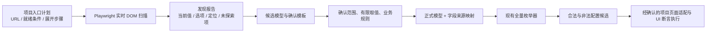

# 页面自动发现

本模块读取运行页面的 DOM，不需要导入被测项目的 Vue 源码。原生表单和 ARIA 控件按通用语义识别，Element Plus 的下拉、日期、级联、数字输入和滑块补充 DOM 适配。只按指定入口展开；隐藏在业务选项后面的状态留待后续明确测试。



本项目的执行层已实现在 [automation/](../../automation/README.md)。它使用本次人工确认的六页分组模型及页面适配，不直接把 `draft-model.json` 当成执行计划。`discover` 仍然只读扫描，不保存配置，也不执行这些 UI 用例。

## 用本项目实例运行

先在 `playground/` 运行 `npm run dev`，使练习站可通过 `http://127.0.0.1:5173/` 访问。以下命令在 `packages/config-enumerator/` 执行：

```bash
npm ci
npm run build
mkdir -p output
npm run discover -- --plan examples/playground-discovery.json --out output/my-discovery
```

默认启动已安装的 Chrome，使用新的隔离浏览器上下文，不连接你的日常浏览器或读取其会话。可加 `--headed` 观察过程。若使用 Playwright 自带 Chromium，先执行 `npx playwright install chromium`，再加 `--channel chromium`；也支持 `--channel msedge`。

输出目录必须是新目录，每次运行保留独立报告。发现退出码：`0` 指定计划完成，`2` 部分发现，`130` 取消，`1` 参数/输出错误。示例计划故意包含一个默认禁用的“选择变量”入口，预期退出码为 **2**，不是整个命令没有结果。

| 产物 | 内容 |
|---|---|
| `report.json` | 计划、逐场景状态、逐状态控件快照、内容指纹、范围限制 |
| `report.md` | 便于阅读的入口结果与候选字段清单 |
| `draft-model.json` | 同一路由内合并的候选字段、逐状态观测、建议取值、待确认项 |
| `review-template.json` | 默认不选任何字段，三个确认项均为 false |

本项目测试覆盖基础输入、复选框联动、扩展控件、配置弹框与显示标签页、动态表格、全部组件页。没有点击新增表格行、业务选项、保存、确认或上传。

## 入口计划

不需要列出每个字段，只需指定页面就绪条件及允许展开的入口。例如：

```json
{
  "id": "my-vue-editor",
  "limits": { "maxSnapshots": 30, "timeoutMs": 5000 },
  "scenes": [{
    "id": "editor-dialog",
    "url": "http://127.0.0.1:5173/#/dialogs",
    "readySelector": "[data-testid=open-config-dialog]",
    "steps": [{
      "kind": "open-dialog",
      "selector": "[data-testid=open-config-dialog]",
      "expectSelector": "[data-testid=control-dialog]"
    }, {
      "kind": "activate-tab",
      "selector": "[role=tab][id$=-display]",
      "expectSelector": "[data-testid=display-precision]"
    }]
  }]
}
```

每个场景先离开原文档再加载 URL，清除 Vue 未保存的界面状态，避免连续同路由扫描沿用前一次弹框；上下文内的登录和已保存存储保留。初始页面和每个成功展开步骤各记录一份快照。不同场景可复用相同前缀，构成多个观察分支；没有自动点击所有按钮或无限 BFS。

| 设置 | 说明 |
|---|---|
| `readySelector` | 唯一且可见的页面就绪标志；异步页面应选择业务区已加载的标志 |
| `scopeSelector` | 可选，默认 body；必须唯一。扫描局部时要注意弹框可能 Teleport 到 body |
| `open-dropdown` | 打开指定下拉、级联或日期选择入口，采集已渲染选项 |
| `activate-tab` | 激活 role=tab 的指定标签页 |
| `open-dialog` | 点击指定按钮并等待可识别的弹框 |
| `expectSelector` | 展开后预期唯一、可见的区域，用于等待和验证观察位置 |

选择器歧义、禁用入口、越界操作、超时会记入报告；不会 force 点击。默认预算：60 快照、每快照 300 控件、每字段 100 选项、文本 500 字符、每次定位/导航等待 5 秒。预算或截断不能标为完整发现。Ctrl+C 在当前有界动作结束后停止后续动作并尽量导出已有结果。

项目指定入口是前提：仅凭按钮名字无法证明另一个系统的打开动作没有副作用；自动保存页面应先选择已确认只读取数据的入口。工具不会主动调用业务写接口或应用存储写 API。

## 观察事实与业务规则

| 页面事实 | 发现结果 | 仍需确认 |
|---|---|---|
| 四个复选框当前未选中 | 当前值 false，建议有限候选 false/true | A/B 互斥、C 依赖 D 等业务关系 |
| 手动输入框 disabled | 保留字段及禁用状态 | 哪个配置允许编辑、期望联动是什么 |
| 原生 select 的 option.value | 保留公开值与显示标签 | 全部取值及非法目标如何建模 |
| 自定义选项只有显示标签 | 记录标签，`valueKnown=false` | 标签到真实业务值的映射 |
| 下拉未公开单/多选语义 | `multiple=null`，不能默认认定单选 | 打开后观察组件 DOM 或人工确认 |
| DOM 的 maxlength/min/max | 记录原始属性，不自动生成规则 | 业务期望与属性实现是否一致 |
| 页面提示最多 100 字符 | 记录可见提示所在属性 | 计数规则及实现是否真的限制 100 字符 |

本实例的备注框按 Unicode 码点在 input 事件里限制长度，DOM **没有 maxlength=100**。扫描会如实记录 placeholder 的提示，不虚构属性，也不会从提示自动批准业务规则。

原生 radio 按组汇总，ARIA radiogroup 和包裹原生输入的 radio 同样支持。滑块与内部数值输入合并成一个候选字段；日期区间保留数组。多选不自动生成全部子集，必须明确完整集合或拆成布尔因子。密码/验证码字段不采集值，文件控件不读取文件路径，本轮不能将它们直接转换为枚举字段。

## 确认后再枚举

编辑本次生成的确认模板，另存为 `reviewed.json`：

1. 只选择属于同一业务配置的字段，设置 `include: true` 并确认字段 `id`。不要把全部组件页与各独立页重复字段一起做笛卡尔积。
2. 为选中字段填入有限 `values`，包括需要测试的非法目标值。界面初始值只是建议样本，不能作为完整值域。
3. 提供真实业务规则；无约束也需明确确认。发现过程不会从默认状态自动推导 A/B/C/D 规则。
4. 核对完范围、值域和规则后，设置 `confirmed.scope/domains/businessRules` 为 true；保留原 `reportId` 与字段 `sourceId`。

```bash
npm run review -- --report output/my-discovery/report.json --review output/my-discovery/reviewed.json --out output/my-model
npm run enumerate -- --model output/my-model/model.json --out output/my-cases
```

确认命令拒绝默认未确认模板、错配报告、重复/未知来源、空取值及无效规则；它只生成 `model.json` 和 `mapping.json`，不会自动启动枚举。报告指纹用于内容一致性核对，不是身份签名或审批系统。

映射保留字段来源、URL、定位和 `observedIn`。可由快照的 `sceneId/afterStep` 回到报告计划，找到**打开到这个字段的已观察路径**；这仍不是“填写目标配置→保存→断言”的完整执行脚本。非法候选保留，后续执行器应验证正常 UI 的禁用、联动、校验行为。

## 接入其他 Vue 项目

安装本包及可选的 `playwright@1.63.0`，修改入口计划的 URL 和选择器即可启动。扫描不依赖此练习站或 Vue 实例。其他组件库在原生/ARIA 信息充分时可直接识别；自绘、复杂复合控件可能需要在 `scan.ts` 增加 DOM 适配，不能宣称自动兼容全部 Vue 组件库。

可直接提供自己创建并已登录的隔离 Playwright Page，CLI 当前没有自动登录功能：

```ts
import { chromium } from 'playwright'
import { discoverPage, createDiscoveryDraft, createReviewTemplate } from '@mes-ui/config-enumerator/discovery'
import plan from './my-discovery-plan.json'

const browser = await chromium.launch({ channel: 'chrome' })
try {
  const context = await browser.newContext()
  const page = await context.newPage()
  // 如需登录，在这个隔离上下文中完成你的测试环境登录流程。
  const report = await discoverPage(page, plan)
  const draft = await createDiscoveryDraft(report)
  const template = createReviewTemplate(draft)
  // 持久化三个对象，完成确认后调用 compileReviewedModel。
} finally {
  await browser.close()
}
```

单次纯扫描可 `page.evaluate(scanDocument, options)`；这不会执行导航或点击。`scanDocument` 的参数类型为 `ScanOptions`。仅使用枚举核心时不需要 Playwright，两个入口独立。

## 验证与边界

```bash
# 核心枚举与 CLI 回归
npm test
# 真实项目实例必须已在 5173 端口启动，默认 Chrome
npm run test:discovery
# 若测试实例使用其他端口
PLAYGROUND_URL=http://127.0.0.1:5174/ npm run test:discovery
```

集成测试在隔离上下文读取运行中的本项目；核对 localStorage 前后相同、业务选项不变、无非读取 HTTP 请求、入口限制和模型转换。补充静态原生组件页只用于密码、ARIA、预算等边界，不能替代项目验收。

目前只扫描主文档普通 DOM。iframe、Shadow DOM、Canvas 未适配；远程、虚拟和分页列表只覆盖当前渲染项。动态表格只观察现有行。强制唯一的结构性 CSS 定位只对当次 DOM 有效，后续回归宜补稳定 testid；弱定位下不同类型/标签不会静默合并成同一字段。不同路由默认分别保留，即使展示相同组件。

语义和读取机制参考：[Playwright Locators](https://playwright.dev/docs/locators)、[Evaluating JavaScript](https://playwright.dev/docs/evaluating)。本模块生成结构化 DOM 记录，未将静态 ASCII 页面图作为运行输入。
