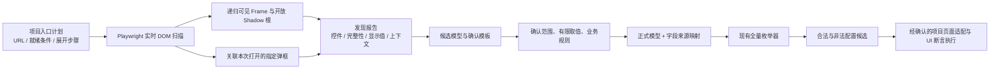

# 页面自动发现

本模块读取运行页面的 DOM，不需要导入被测项目的 Vue 源码。原生表单和 ARIA 控件按通用语义识别，Element Plus 的下拉、日期、级联、数字输入和滑块补充 DOM 适配。只按指定入口展开；隐藏在业务选项后面的状态留待后续明确测试。



本项目的执行层已实现在 [automation/](../../automation/README.md)。它使用原六页和发现验证页各自明确的分组模型及页面适配，不直接把 `draft-model.json` 当成执行计划。`discover` 仍然只读扫描，不保存配置，也不执行这些 UI 用例。

## 用本项目实例运行

先在 `playground/` 运行 `npm run dev`，使练习站可通过 `http://127.0.0.1:5173/` 访问。以下命令在 `packages/config-enumerator/` 执行：

```bash
npm ci
npm run build
mkdir -p output
npm run discover -- --plan examples/playground-discovery.json --out output/my-discovery
# 四类发现能力的独立验证页
npm run discover -- --plan examples/discovery-evidence.json --out output/my-evidence
```

默认启动已安装的 Chrome，使用新的隔离浏览器上下文，不连接你的日常浏览器或读取其会话。可加 `--headed` 观察过程。若使用 Playwright 自带 Chromium，先执行 `npx playwright install chromium`，再加 `--channel chromium`；也支持 `--channel msedge`。

输出目录必须是新目录，每次运行保留独立报告。发现退出码：`0` 指定计划完成，`2` 部分发现，`130` 取消，`1` 参数/输出错误。示例计划故意包含一个默认禁用的“选择变量”入口，预期退出码为 **2**，不是整个命令没有结果。

| 产物 | 内容 |
|---|---|
| `report.json` | 计划、逐场景状态、逐状态控件快照、内容指纹、范围限制 |
| `report.md` | 便于阅读的入口结果与候选字段清单 |
| `draft-model.json` | 同一路由内合并的候选字段、逐状态观测、建议取值、待确认项 |
| `review-template.json` | 默认不选任何字段，三个确认项均为 false |

原六页计划仍覆盖基础输入、联动、扩展控件、弹框标签页、表格和全部组件页：12 个场景、20 个快照，默认禁用的内层变量入口保持未探索。

新增 `/#/discovery`“发现验证”页，计划 `examples/discovery-evidence.json` 覆盖 10 个场景、21 个快照：两层 Teleport、无关同名弹框、分页/虚拟/远程选项、同 URL 的兄弟 Frame、嵌套和跨源 Frame、嵌套开放 Shadow 根、Shadow 内 Frame、显示格式。它已独立接入 UI 执行：新增 204 条配置 + 8 条操作场景，默认目录从原六页 2453 条增加到七页 2665 条。根目录 `npm run test:ui -- --scope discovery` 执行新页全部 212 条，`npm run test:ui:smoke -- --scope discovery --way 2` 生成并执行真实 PICT 冒烟，自动生成中文报告。详见 [覆盖规格](../../openspec/changes/execute-discovery-validation-page/coverage-review.md)。发现命令本身仍只负责观察。

没有点击新增表格行、业务选项、保存、确认或上传。远程实例真实 GET 本项目静态 JSON；这不是连接真实 MES 的接口验收。

## 入口计划

不需要列出每个字段，只需指定页面就绪条件及允许展开的入口。例如：

```json
{
  "schemaVersion": 2,
  "id": "my-vue-editor",
  "limits": { "maxSnapshots": 30, "timeoutMs": 5000 },
  "scenes": [{
    "id": "editor-dialog",
    "url": "http://127.0.0.1:5173/#/discovery",
    "ready": { "selector": "[data-testid=discovery-ready]" },
    "scope": { "selector": "[data-testid=discovery-editor]" },
    "steps": [{
      "kind": "open-dialog",
      "target": { "selector": "[data-testid=open-evidence-dialog]" },
      "expected": { "selector": "[data-testid=evidence-dialog]" }
    }, {
      "kind": "open-dialog",
      "target": { "selector": "[data-testid=open-inner-evidence]" },
      "expected": { "selector": "[data-testid=inner-evidence-dialog]" }
    }]
  }]
}
```

每个场景先离开原文档再加载 URL，清除 Vue 未保存的界面状态，避免连续同路由扫描沿用前一次弹框；上下文内的登录和已保存存储保留。初始页面和每个成功展开步骤各记录一份快照。不同场景可复用相同前缀，构成多个观察分支；没有自动点击所有按钮或无限 BFS。

| 设置 | 说明 |
|---|---|
| `ready` | 唯一且可见的就绪元素地址；异步页面应选择业务区已加载的标志 |
| `scope` | 可选，默认 body；初始扫描根必须唯一且可见；弹框打开后自动加入扫描范围，可继续读取背景已禁用的场景 |
| `framePath` | 从主文档到场景所在 Frame 的 iframe 地址数组，省略表示主文档 |
| `open-dropdown` | 打开指定下拉、级联或日期选择入口，采集已渲染选项 |
| `activate-tab` | 激活 role=tab 的指定标签页 |
| `open-dialog` | 点击指定按钮并等待可识别的弹框 |
| `target` / `expected` | 入口及目标的精确根内地址；弹框的 expected 必须是 dialog / role=dialog 根 |

选择器歧义、禁用入口、越界操作、超时会记入报告；不会 force 点击。默认预算：60 快照、每快照累计 300 控件和 300 单元格、每字段 100 选项、文本 500 字符、每次定位/导航等待 5 秒、每快照 20 个文档（含扫描起点）、Frame 深度 4、开放 Shadow 深度 8。预算或截断不能标为完整发现。Ctrl+C 在当前有界动作结束后停止后续动作并尽量导出已有结果。

项目指定入口是前提：仅凭按钮名字无法证明另一个系统的打开动作没有副作用；自动保存页面应先选择已确认只读取数据的入口。工具不会主动调用业务写接口或应用存储写 API。

## 四类发现证据

### 弹框关联

先验证目标弹框不存在或不可见，点击指定入口，再等待该目标可见且具有弹框根语义。记录 `associations`：入口、目标、名称、步骤、父弹框、Frame 上下文及 `hidden-to-visible` 转换。

扫描范围是“原 scope + 本场景已关联的弹框”。因此 Vue Teleport 到 body 的内容可被采集，范围外无关弹框不会混进来。弹框令原编辑器变为 inert 或 aria-hidden 时，仍读取已关联的可见弹框。若 scope 本来就是 body，已有弹框可以作为当前页面事实被观察，但不会冒充本次操作打开的弹框。已可见目标、歧义定位、错误根、禁用入口均停止该入口并报告。关联基于指定目标及可见性变化，不推断任意同名“确定”按钮属于哪个窗口。

Element Plus 的 `data-testid` 可能落在没有 dialog 角色的内部容器，本项目使用 `[role=dialog]:has(> [data-testid=control-dialog])` 定位真实弹框根。

### 选项完整性

每个有选项的字段保存 `optionCoverage`，包含状态、来源、观测数、声明总数及原因。**只表示当前集合的证据，不证明整个系统的业务全集。**

| 状态 | 判定依据 | 实例 |
|---|---|---|
| `complete` | 原生 select 全部 DOM options；或自定义选项的 aria-setsize 一致且位置完整覆盖 1..N，未加载、未截断 | 原生 3/3、自定义 5/5 |
| `partial` | 明确还在加载、仅观察到声明总数的一部分，或预算截断 | 分页 2/5、虚拟片段 3/100、远程加载中 |
| `unknown` | 没有足够一致的总数/位置证据，不能证明完整 | 只见 2 项却不知道总数、矛盾声明 |

不会自动翻页、滚动穷尽、切换搜索条件或把多次快照的集合拼成全集。远程列表等待什么由 `ready` 决定；若加载完成才允许采集，应提供相应就绪标志。对于完整配置枚举，仍应确认受控数据集或有明确终止条件的遍历结果。草稿保留逐快照证据，不能用最后一次 complete 抹掉其他状态的 partial。

### Frame 和开放 Shadow DOM

地址格式统一为 `{ "selector": "...", "shadowPath": ["宿主1", "宿主2"] }`。selector 只在自己的 Document / ShadowRoot 中查询；shadowPath 逐层进入开放根，默认空数组。每段都要求唯一，**不使用全局自动穿透定位去猜同名元素**。

```json
{
  "framePath": [{ "selector": "[data-testid=frame-one]" }],
  "target": {
    "selector": "[data-testid=shadow-open]",
    "shadowPath": ["[data-testid=frame-shadow]"]
  }
}
```

这是地址片段；完整场景还需 URL、ready、steps 等。Frame 路径中的 iframe 本身也可以位于开放 Shadow 根。扫描递归处理范围内可见 iframe，包括浏览器能够访问的跨源子文档；`documents` 分别记录 `scanned`、`unavailable`、`limited`。跨源不通过父页面 JavaScript 读取，而由 Playwright 进入对应 Frame。

控件和单元格携带 `context.url`、`context.framePath`、`locator.shadowPath`。同 URL 的兄弟 Frame、主文档和 Shadow 中重复的 ID 不合并。字段来源映射保留这些地址，可通过导出的 `enterFrames`、`findElement` 重新定位。结构性定位只对当次 DOM 有效，生产回归宜补稳定 testid。原生 radio-group 的来源定位表示一组选项，回放应在对应根内按组选择具体选项，不能直接交给要求单元素的 findElement。

闭合 Shadow 根和 Canvas 内部不支持。Frame 无法进入、预算不足、Shadow 过深均记录部分发现；本功能不能证明完全没有不可见或闭合的组件。

### 单元格显示值

原生 table 及 ARIA table/grid 的可见单元格独立存放于 `snapshot.cells`：

- `displayText`：可见渲染文本（innerText，空白规范化），隐藏子元素不混入；`displayTruncated` 标记文本截断。
- `businessValue` / `valueKnown`：仅读取显式 `data-discovery-value` JSON；未知时为 null / false，不从显示文本猜测，也不读 Vue 私有状态。
- `table`、`row`、`rowKey`、`rowIndex`、`columnKey`、`columnIndex`、`columnLabel` 及文档/Shadow 地址：定位同一条证据。行键来自 `data-row-key`，列键来自 `data-column-key`；缺少业务键时只保留结构定位或序号。

实例：`<td data-discovery-value="12.3">12.30 kg</td>` 会分别记录数字 12.3 和文本 `12.30 kg`。后续断言应使用独立规格同时判断数值及精度/单位显示，不能用被测显示反推预期。采集不等于像素级视觉校验；CSS 伪元素、图片和 Canvas 需额外适配或截图断言。复杂多级表头、合并单元格应优先提供明确行列键。

单元格不会自动变成枚举因子。只采集当前渲染行，不宣称表格全量数据已发现。

发现计划、报告、草稿、映射统一为 `schemaVersion: 2`，旧版数据拒绝转换；请更新入口计划并重新发现。枚举核心模型格式不受影响。

## 观察事实与业务规则

| 页面事实 | 发现结果 | 仍需确认 |
|---|---|---|
| 四个复选框当前未选中 | 当前值 false，建议有限候选 false/true | A/B 互斥、C 依赖 D 等业务关系 |
| 手动输入框 disabled | 保留字段及禁用状态 | 哪个配置允许编辑、期望联动是什么 |
| 原生 select 的 option.value | 保留公开值与显示标签 | 全部取值及非法目标如何建模 |
| 自定义选项只有显示标签 | 记录标签，`valueKnown=false` | 标签到真实业务值的映射 |
| 下拉未公开单/多选语义 | `multiple=null`，不能默认认定单选 | 打开后观察组件 DOM 或人工确认 |
| DOM 的 maxlength/min/max | 记录原始属性，不自动生成规则 | 业务期望与属性实现是否一致 |
| 页面提示最多 100 字符 | 记录可见提示所在属性 | 计数规则及实现是否真的限制 100 字符 |

本实例的备注框按 Unicode 码点在 input 事件里限制长度，DOM **没有 maxlength=100**。扫描会如实记录 placeholder 的提示，不虚构属性，也不会从提示自动批准业务规则。

原生 radio 按组汇总，ARIA radiogroup 和包裹原生输入的 radio 同样支持。滑块与内部数值输入合并成一个候选字段；日期区间保留数组。多选不自动生成全部子集，必须明确完整集合或拆成布尔因子。密码/验证码字段不采集值，文件控件不读取文件路径，本轮不能将它们直接转换为枚举字段。

## 确认后再枚举

编辑本次生成的确认模板，另存为 `reviewed.json`：

1. 只选择属于同一业务配置的字段，设置 `include: true` 并确认字段 `id`。不要把全部组件页与各独立页重复字段一起做笛卡尔积。
2. 为选中字段填入有限 `values`，包括需要测试的非法目标值。界面初始值只是建议样本，不能作为完整值域。
3. 提供真实业务规则；无约束也需明确确认。发现过程不会从默认状态自动推导 A/B/C/D 规则。
4. 核对完范围、值域和规则后，设置 `confirmed.scope/domains/businessRules` 为 true；保留原 `reportId` 与字段 `sourceId`。

```bash
npm run review -- --report output/my-discovery/report.json --review output/my-discovery/reviewed.json --out output/my-model
npm run enumerate -- --model output/my-model/model.json --out output/my-cases
```

确认命令拒绝默认未确认模板、错配报告、重复/未知来源、空取值及无效规则；它只生成 `model.json` 和 `mapping.json`，不会自动启动枚举。报告指纹用于内容一致性核对，不是身份签名或审批系统。

映射保留字段来源、页面 URL、Frame 上下文、Shadow/根内定位和 `observedIn`。可由快照的 `sceneId/afterStep` 回到报告计划，找到**打开到这个字段的已观察路径**；这仍不是“填写目标配置→保存→断言”的完整执行脚本。非法候选保留，后续执行器应验证正常 UI 的禁用、联动、校验行为。

## 接入其他 Vue 项目

安装本包及可选的 `playwright@1.63.0`，修改入口计划的 URL 和选择器即可启动。扫描不依赖此练习站或 Vue 实例。其他组件库在原生/ARIA 信息充分时可直接识别；自绘、复杂复合控件可能需要在 `scan.ts` 增加 DOM 适配，不能宣称自动兼容全部 Vue 组件库。

可直接提供自己创建并已登录的隔离 Playwright Page，CLI 当前没有自动登录功能：

```ts
import { chromium } from 'playwright'
import { discoverPage, createDiscoveryDraft, createReviewTemplate } from '@mes-ui/config-enumerator/discovery'
import plan from './my-discovery-plan.json'

const browser = await chromium.launch({ channel: 'chrome' })
try {
  const context = await browser.newContext()
  const page = await context.newPage()
  // 如需登录，在这个隔离上下文中完成你的测试环境登录流程。
  const report = await discoverPage(page, plan)
  const draft = await createDiscoveryDraft(report)
  const template = createReviewTemplate(draft)
  // 持久化三个对象，完成确认后调用 compileReviewedModel。
} finally {
  await browser.close()
}
```

单文档纯扫描可 `frame.evaluate(scanDocument, options)`；这不会导航或点击，也不会自行进入子 Frame。`ScanOptions` 中设置 `scopes` 地址数组、`framePath` 及采集预算；需要递归 Frame 和关联弹框时使用 `discoverPage`。仅使用枚举核心时不需要 Playwright，两个入口独立。

## 验证与边界

```bash
# 核心枚举与 CLI 回归
npm test
# 真实项目实例必须已在 5173 端口启动，默认 Chrome
npm run test:discovery
# 若测试实例使用其他端口
PLAYGROUND_URL=http://127.0.0.1:5174/ npm run test:discovery
```

集成测试在隔离上下文读取运行中的本项目；核对 localStorage 前后相同、业务选项不变、无非读取 HTTP 请求、入口限制和模型转换。补充静态原生组件页只用于密码、ARIA、预算等边界，不能替代项目验收。

真实浏览器测试还覆盖弹框关联、选项完整性、跨源/嵌套 Frame、开放 Shadow、重复字段身份、定位复用、显示文本、错误关联和预算。弱定位下不同类型/标签不会静默合并成同一字段；不同路由默认分别保留，即使展示相同组件。验收结果见 [本次验收记录](../../../openspec/changes/complete-discovery-evidence/verification.md)。

语义和读取机制参考：[Playwright Locators](https://playwright.dev/docs/locators)、[Evaluating JavaScript](https://playwright.dev/docs/evaluating)。本模块生成结构化 DOM 记录，未将静态 ASCII 页面图作为运行输入。
