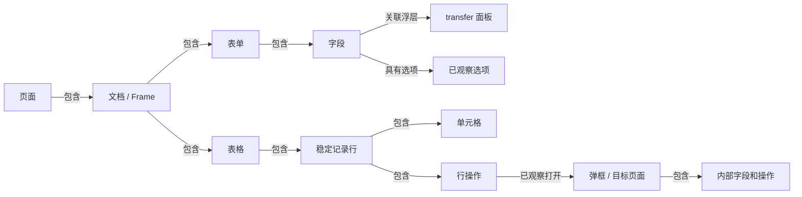

# UI 元素关系模型

工作流另有 `workflow.json`，模型包含 `workflow`、`workflow-node` 和 `connects-to`。节点 ID 限当前工作流快照；执行时按本轮业务名称、类型及前后关系解析，详见 [工作流节点定位](WORKFLOW.md)。

发现命令现在自动导出 `ui-model.json` 和 `ui-model.md`。模型把逐次扫描中的控件、容器和打开路径连起来，支持查询某条记录有哪些操作、字段属于哪个表单、下拉使用哪个浮层、入口实际打开过哪个界面。它独立于需要人工确认的 `draft-model.json` 配置模型。



每个箭头均需要证据。某次动作失败、尚未执行或端点无法可靠匹配时，不生成一个看起来正确的打开关系。单纯同名、共同出现或前后变化不构成依赖关系。

## 根据真实代码处理的情况

| 源码依据 | 模型处理 |
|---|---|
| [JTH 定位适配](../../真实项目代码/JTH/src/libs/test-id.js)、[EBR 定位适配](../../真实项目代码/EBR/src/libs/test-id.js) 将标识放在原生输入、触发器和 transfer 面板 | 组合组件保留内部实际目标地址；面板通过 ARIA、指定展开步骤或准确的 `base / base-trigger / base-panel` 约定关联。限定已识别 md/iView 封装和唯一可见归属，不对任意字符串拆层级 |
| [法人列表](../../真实项目代码/JTH/src/view/mgt/org/legal/index.vue) 的 `row-key-field="cor_code"`，定位适配生成主表和固定列的稳定行标识 | 行身份来自完整稳定定位，行操作和单元格挂在实际所属行；排序不改变记录身份，固定列与主表分别记录。未公开原始行键时保留 `rowKey: null`，不反向拆解可能含连字符的编号 |
| [编辑页面](../../真实项目代码/JTH/src/view/mgt/org/legal/legalEdit.vue) 的公共输入、选择弹框和状态性禁用 | 同一个元素保留多份观察状态；弹框内字段通过容器链关联；打开记录保留当时的场景、路径和快照 |
| 同一编辑弹框可用于不同记录，Frame/Shadow 内可复用控件名 | 身份包含完整页面 URL（保留 query/hash）、Frame 路径、文档 URL、Shadow 路径和稳定定位；状态不覆盖成一个最终值 |

本次核对了这些源码约定并在扫描器中适配，没有实现通用 Vue/JavaScript 源码依赖分析。`v-model`、`watch`、条件渲染表达式之间的业务依赖，以及后台校验规则，不会自动转换成已确认关系。当前真实组件验证使用 JTH 已安装的 Vue 2、view-design 和 md-mes-plus，加上实际 MdTable/MdTableLazy 源码；这不等于 EBR 所声明依赖版本或全部业务页面通过验收。

## 数据结构与证据

- `elements`：页面、文档、表单、字段、操作、弹框、表格、行、单元格、区域、浮层、选项。`kinds` 允许一个实际元素具有多种观察角色。
- `observations`：`snapshotId`、原报告中的 `source`、当时名称和 `state`。控件状态包含值是否已知、禁用/只读、DOM 约束、选项完整性、入口点击边界等；单元格保留显示值与显式业务值的区别。
- `relations`：`contains`（包含）、`has-option`（选项归属）、`has-popup`（浮层归属）、`opens`（已观察的展开/导航）。每条边有快照和依据；弹框逻辑嵌套的依据与普通 DOM 祖先关系分别记录。
- `configurationFields`：现有候选配置字段 `sourceId` 到元素 `elementId` 的映射，便于从配置字段回查界面结构。配置确认门槛保持不变。
- `snapshots`：场景、步骤和探索路径。重复使用同一个弹框的各次状态保留为不同观察，不按同名字段覆盖数据。
- `limitations`：未定位、截断、缺失端点、选项未知等。`observed` 只表示当前指定范围的证据已经建模；`partial` 表示仍存在缺口。两者都不表示测试通过。

`locatable` 表示曾有可唯一回查的地址，不保证元素现在可见，也不授予点击权限。执行前仍须重新扫描和定位。缺席可能由扫描范围变化造成，不能自动解释为隐藏。未知定位只生成当前快照内的观察身份，不跨状态合并。未知选项值保留未知；数值 `0`、字符串 `"0"` 与 `false` 不混同。

## 使用

现有命令不变，在本包目录执行：

```sh
npm run build
mkdir -p output
npm run discover -- --plan examples/discovery-evidence.json --out output/my-ui-model
```

该命令需要运行中的练习站，详见 [发现说明](DISCOVERY.md)。输出包含原来的报告、候选字段和确认模板，以及新增的两个关系模型文件；CLI 退出状态仍由发现报告决定，模型状态单独查看。

已有且指纹有效的报告也可以转换；缺少新增结构证据的报告会明确标为部分覆盖，建议重新扫描。

```js
import {
  createUiElementModel, findUiRelations,
} from '@mes-ui/config-enumerator/discovery';

const model = await createUiElementModel(report);
const row = model.elements.find(element =>
  element.kinds.includes('row') &&
  element.locator?.selector === '[data-testid="org-legal-list-table-row-COR-001"]'
);
if (row) {
  const links = findUiRelations(model, row.id, {
    direction: 'outgoing', kind: 'contains',
    // snapshotId: 'scene:1', // 可限定某次观察
  });
  const children = links.map(link => model.elements.find(e => e.id === link.to));
  const actions = children.filter(element => element.kinds.includes('action'));
  console.log(actions);
}
```

API 只查询关系，不自动执行返回的操作。当前只查询直接联系，多级关系可按业务需要逐层查询，不提供隐式动作规划或保存行为。

## 可复现验证

```sh
# 有限枚举、模型身份、证据及配置边界
npm test
# 需先启动 playground，包含已有发现回归和新的关系浏览器测试
npm run test:discovery
```

真实组件验证另行执行：先从工作区根目录启动 `node 真实项目代码/test-ids/serve-fixture.cjs`，再使用它打印的本地 URL，在本包目录运行：

```sh
npm run build
MES_COMPONENT_URL=http://127.0.0.1:实际端口/ \
  node --test test/integration/mes-components.test.mjs
```

可选 `UI_RELATIONS_OUT` 指定本次验证输出目录。它使用本地固定数据，不连接业务后端。真实 MES 的登录态、接口持久化、完整菜单遍历和跨业务依赖仍未验收。

Handsontable 批记录网格支持零前端改动的只读采集，发现命令新增 `handsontable.json`；值、格式、合并、副本关系和断言示例见 [Handsontable 读取器](HANDSONTABLE.md)。仅覆盖当前渲染 DOM，原始业务值与跨任务身份不推断。
